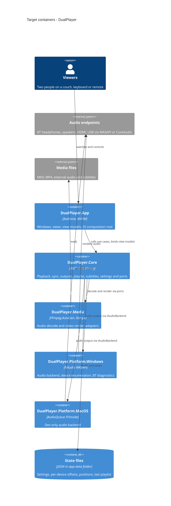

# Architecture map — DualPlayer (MediaPlayer repo)

> **Target foundation** (greenfield-bootstrap): what `/sdd:scaffold` materializes and every feature
> builds into. Produced by `survey` from `docs/idea-brief.md`, `docs/roadmap.md` and the owner's
> choices. Paths below are the *planned* layout — none exist until scaffold runs. Refresh with
> `survey` once the skeleton exists and drifts past `reflects_commit`.

## Stack

- Language / runtime: C# on .NET 10 LTS — chosen over the brief's .NET 8 (support ended 2026-11-10) → [ADR-0001](adr/0001-use-dotnet10-and-avalonia.md)
- UI: Avalonia 11.x + CommunityToolkit.Mvvm (MVVM: Views render, ViewModels hold logic and are unit-testable)
- Video: libmpv (render API into an Avalonia OpenGL control), audio disabled in mpv; timing slaved to the audio master clock (roadmap D1)
- Audio decode: FFmpeg via FFmpeg.AutoGen
- Audio output: behind an `IAudioBackend` port — Windows: NAudio WASAPI (own N-device event-driven render loop, MMCSS "Pro Audio" via avrt.dll P/Invoke); macOS (dev only): own P/Invoke to AudioToolbox AudioQueue → [ADR-0002](adr/0002-put-audio-output-behind-a-backend-port.md)
- Build / test / lint: `dotnet build` / `dotnet test` (xUnit v3 + Shouldly + NSubstitute) / `dotnet format --verify-no-changes` + .NET analyzers with warnings-as-errors
- Logging: Microsoft.Extensions.Logging + Serilog rolling file sink
- Packages: central package management (`Directory.Packages.props`); shared build settings (`Directory.Build.props`: nullable enabled, `TreatWarningsAsErrors`, `AnalysisLevel=latest`)

## C4 — target baseline

## Module inventory

Style: ports and adapters → [ADR-0003](adr/0003-organize-code-as-core-with-platform-adapters.md). `DualPlayer.Core` references no OS, UI or native library; adapters implement its ports; `DualPlayer.App` is the only composition root.

| Module | Path | Layers | Wired at | Responsibility |
|---|---|---|---|---|
| DualPlayer.Core | `src/DualPlayer.Core/` (new) | domain + ports, by area: `Playback/`, `Sync/`, `Outputs/`, `Playlist/`, `Subtitles/`, `Settings/`, `Diagnostics/` | `src/DualPlayer.App/` DI setup (new) | Master clock, drift correction, output model, use cases; defines `IAudioBackend`, `IAudioDecoder`, `IVideoRenderer`, `IDeviceWatcher`, `IStateStore` |
| DualPlayer.Media | `src/DualPlayer.Media/` (new) | adapters | App DI (new) | FFmpeg audio decoder, libmpv video renderer |
| DualPlayer.Platform.Windows | `src/DualPlayer.Platform.Windows/` (new) | adapters, `[SupportedOSPlatform("windows")]` | App DI, selected when `OperatingSystem.IsWindows()` (new) | WASAPI render loop, device enumeration/hotplug, BT diagnostics |
| DualPlayer.Platform.MacOS | `src/DualPlayer.Platform.MacOS/` (new) | adapters, `[SupportedOSPlatform("macos")]` | App DI, selected when `OperatingSystem.IsMacOS()` (new) | Dev-only AudioQueue backend |
| DualPlayer.App | `src/DualPlayer.App/` (new) | UI: `Views/`, `ViewModels/`, `Controls/`, `Themes/` | `Program.cs` (new) | Avalonia app, composition root, input handling |
| Tests | `tests/DualPlayer.Core.Tests/`, `tests/DualPlayer.App.Tests/`, `tests/DualPlayer.Platform.Windows.Tests/` (new) | — | `DualPlayer.slnx` (new) | Unit tests per module; Windows adapter tests run only on Windows |
| Sync rig | `tools/sync-rig/` (new) | tool | — | Developer click/flash sync verification (roadmap step 12) |
| Packaging | `build/` (new) | build scripts | — | Self-contained win-x64 publish + installer (roadmap step 13) |

## Conventions (cited — the rules a new feature must match)

All citations point to files scaffold creates; until then they are targets, not evidence.

- **Module wiring / registration:** each module exposes `IServiceCollection Add<Module>(this IServiceCollection)`; only `DualPlayer.App` calls them — `src/DualPlayer.App/Program.cs` (new)
- **Platform selection:** runtime check `OperatingSystem.IsWindows()` / `IsMacOS()` in the composition root; all projects target plain `net10.0` so the solution builds on macOS — `src/DualPlayer.App/Program.cs` (new)
- **Error handling:** expected runtime failures (device lost, file unreadable, decoder error) are returned as a `Result<T>` / domain event, never thrown across module boundaries; exceptions mean bugs and are logged at the top of each background loop — `src/DualPlayer.Core/Result.cs` (new)
- **Time and clocks:** no `DateTime.Now` / `Stopwatch` in Core; time comes from an injected `TimeProvider` or the audio master clock, so sync logic is testable with fakes — `src/DualPlayer.Core/Sync/` (new)
- **Threading:** audio render loops run on dedicated threads (MMCSS on Windows), never on the UI thread; UI updates marshal through `Dispatcher.UIThread` — `src/DualPlayer.Platform.Windows/` (new)
- **IDs:** audio devices keyed by the OS endpoint ID string; media files keyed by normalized absolute path + size + mtime — `src/DualPlayer.Core/Outputs/`, `src/DualPlayer.Core/Playlist/` (new)
- **Persistence:** JSON files via System.Text.Json source-generated contexts in the per-user app-data folder (`%APPDATA%/DualPlayer`, macOS `~/Library/Application Support/DualPlayer`); atomic write (temp + rename) → [ADR-0004](adr/0004-store-state-as-versioned-json-files.md) — `src/DualPlayer.Core/Settings/` (new)
- **Migrations:** no DB. Each JSON file carries `schemaVersion`; an ordered chain of in-code upgraders lifts old files on load — `src/DualPlayer.Core/Settings/` (new)
- **Tests:** xUnit v3 + Shouldly + NSubstitute; one test project per module under `tests/`; sync logic tested with fake clock + fake audio device; tests needing real audio hardware use a `[HardwareFact]` attribute that skips unless `DUALPLAYER_HARDWARE=1` — `tests/DualPlayer.Core.Tests/` (new)
- **Logging:** `ILogger<T>` everywhere; Serilog rolling file in the app-data `logs/` folder; sync/underrun counters logged as structured events — `src/DualPlayer.App/Program.cs` (new)
- **Inter-module communication:** direct calls through Core ports; Core raises domain events (C# events / `IObservable`) that ViewModels subscribe to — `src/DualPlayer.Core/` (new)
- **CI:** GitHub Actions matrix `windows-latest` + `macos-latest`: build + test + lint — `.github/workflows/ci.yml` (new); no remote exists yet
- **UI / styling:** Avalonia Fluent theme, dark variant, with the app's own resource dictionary of tokens (sizes for 1080p, scaled by window height) — detail in §Frontend / UI foundation

## Datastores

| Store | Engine | Accessed via | Notes |
|---|---|---|---|
| State files | JSON files, per-user app-data folder | `IStateStore` port (Core) | Settings, per-device latency offsets, per-file positions and tracks, last playlist; `schemaVersion` per file |
| Logs | Serilog rolling text files | `ILogger<T>` | Sync/underrun/drift diagnostics |

## Frontend / UI foundation

Nothing exists yet; this is the foundation every `ui`-layer task composes against.

- **Component library / design system:** Avalonia Fluent theme (dark) + in-repo controls in `src/DualPlayer.App/Controls/` (new); a design canon (`docs/design-system.md`) does not exist yet
- **Design tokens:** one resource dictionary `src/DualPlayer.App/Themes/Tokens.axaml` (new) holding the brief's 1080p sizes (body ≥ 32 px, headings ≥ 48 px, minimum 24 px, buttons ≥ 96×96, focus border 4 px, contrast ≥ 7:1), scaled by window height and the UI-scale setting
- **Styling approach:** Avalonia styles + `ControlTheme`s in `src/DualPlayer.App/Themes/` (new); no per-view inline styling
- **Shared primitives:** focusable large button, output tile, side panel, banner notification, menu list — added under `src/DualPlayer.App/Controls/` as roadmap step 8 builds them
- **State / data-fetching:** CommunityToolkit.Mvvm `ObservableObject` / `[RelayCommand]` ViewModels in `src/DualPlayer.App/ViewModels/` (new)
- **Closest UI precedent:** none yet; the first screen (roadmap step 4's playback window) becomes the precedent

## Where things live / closest precedents

- A new playback/audio capability → domain + port in `src/DualPlayer.Core/<Area>/`, OS-specific part as an adapter in `src/DualPlayer.Platform.Windows/` (and a dev stub in `.MacOS/` if needed).
- A new codec/media concern → `src/DualPlayer.Media/`.
- A new screen / UI component → View + ViewModel in `src/DualPlayer.App/`, composed from `Controls/` and `Themes/Tokens.axaml`.
- A new persisted setting → a record in `src/DualPlayer.Core/Settings/` + bump `schemaVersion` + an upgrader.

## Constraints & known tech-debt

- Target is Windows 11 x64; development on macOS — every project must build on both; WASAPI code runs only on Windows.
- The macOS audio backend is dev-only — it is never shipped and is not held to the sync targets.
- libmpv is LGPL — dynamically linked only (`libmpv-2.dll` beside the exe); FFmpeg builds must also be LGPL.
- Native dependencies on the dev Mac (libmpv, FFmpeg shared libs) are installed outside the repo (e.g. Homebrew); on Windows they ship in the package.
- The .NET SDK is not installed on the dev Mac as of this survey — install .NET 10 SDK before `/sdd:scaffold`.
- No git remote yet — CI config is written but runs only once a GitHub remote is added.
- libmpv video can only be slaved approximately (speed/seek) to an external clock — roadmap D1 may force an own FFmpeg video path inside `DualPlayer.Media`.

## Reconciliation with the authored architecture doc

No authored architecture doc; this map is the current reference. It refines `docs/idea-brief.md §1` (8. Architecture and stack): .NET 8 → .NET 10 (ADR-0001); the brief's module list (PlaybackEngine, SyncController, AudioDeviceService, SubtitleService, PlaylistService, SettingsStore, RemoteServer) maps onto `DualPlayer.Core` areas plus platform adapters; architecture B (one engine, one clock) replaces the two-libmpv-instance design per `docs/idea-brief.md §7`.
