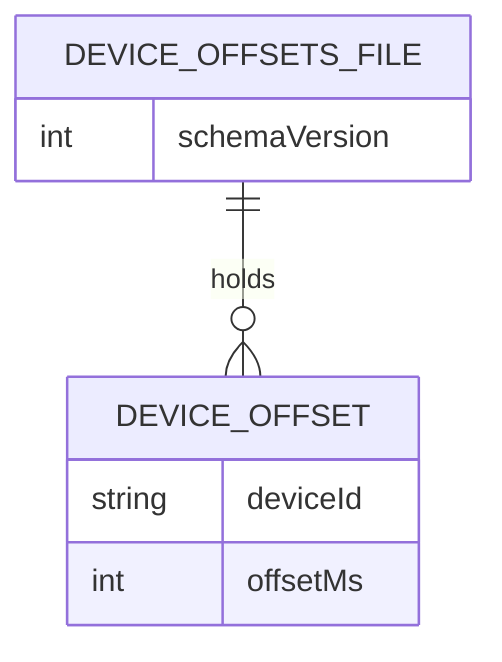

# Data model — lip-synced-video

The project has no database. Persistent state is versioned JSON files in the per-user app-data folder, read and written through `IStateStore` (project ADR-0004; `src/DualPlayer.Core/Settings/`). This feature adds one such file, `device-offsets.json` (`sad.md` ADR-0006), holding the only state that outlives a run: each device's offset. Everything else the feature computes — reported part, type default, assumed latency, picture delay, lags — is worked out again at every start and is never stored (spec AC-12).

## ER diagram



## Entities

### `DeviceOffsets` — file `device-offsets.json` (aggregate root)

| Field | JSON type | Constraints | Notes |
|---|---|---|---|
| `schemaVersion` | integer | required; `1` | `IStateStore` runs the upgrader chain from this value; a file newer than the code is `state.too-new` |
| `offsets` | object: device id → integer | required; may be empty | one entry per device that ever had an offset other than its first-use 0 |

### `DeviceOffset` — one entry of `offsets`

| Field | JSON type | Constraints | Notes |
|---|---|---|---|
| key | string | the OS endpoint id, verbatim | `CLAUDE.md` IDs; one id may stand for several physical devices on one jack (spec §8, accepted) |
| value | integer (ms) | −500…+500, multiple of 10 | positive = sound heard later (`CONTEXT.md` Offset); on load, out-of-range values are clamped and off-grid values rounded to 10 ms, each logged (spec §6.1) |

Example (no real ids):

```json
{
  "schemaVersion": 1,
  "offsets": {
    "{0.0.0.00000000}.{example-device-a}": 40,
    "{0.0.0.00000000}.{example-device-b}": -20
  }
}
```

**Aggregate root:** `DeviceOffsets` — the whole file is loaded at start and replaced atomically on save (temp + rename); entries have no identity outside it.
**Access patterns:**
- Start (sequence flow 1): load the file once, look up each output's device id → in-memory dictionary, no index needed.
- Offset key (sequence flow 8): update one entry in memory; save the whole file ≤ 1 s after the last press (debounced).
- Unreadable or invalid file: start with every offset at 0, warn in the terminal and the log, do not overwrite the file until a Viewer presses an offset key (spec §6.1).

**Code shape (follows `AppSettingsFile`):** `Core/Settings/DeviceOffsetsFile.cs` exposes a `StateFileDefinition<DeviceOffsets>` with file name `device-offsets.json`, `CurrentVersion = 1`, default = empty map, and an empty upgrader list — the file is new at v1, so no v0 shape ever existed. A source-generated `JsonSerializerContext` (camelCase, indented), as `SettingsJsonContext` does. Any future field bumps `CurrentVersion` and adds an `IStateUpgrader` from the previous version (`CLAUDE.md` Migrations).

**Privacy:** only endpoint ids and integers; no device names (spec §6.1).

## Indexes

None. The file is a single small JSON document loaded into memory; every lookup is a dictionary access by device id.

| Index | Columns | Query it serves |
|---|---|---|
| — | — | no stored query; lookup by device id happens in memory after load |

## Test fixtures

Not in any migrations folder; built in the test projects the way `tests/DualPlayer.Core.Tests` already builds state (temp directory + `JsonFileStateStore`):

- `DeviceOffsetsBuilder.With(deviceId, offsetMs)` — an in-memory `DeviceOffsets` for `OffsetBook` and `LatencyModel` tests, ids like `test-device-1`.
- Raw JSON fixtures for load edge cases: out-of-range value (`900`), off-grid value (`15`), unknown future `schemaVersion` (`2`), malformed JSON, missing `offsets`.
