# Software Architecture Document — lip-synced-video

<!-- 12 Arc42 sections. Empty section → <!-- N/A: <one-line reason> -->. -->
<!-- C4 Context (L1) lives inline in §3. C4 Container (L2) lives inline in §5. -->
<!-- Numbers in §10 come VERBATIM from spec.md §6 NFR — no inventing, no rounding. -->

## 1. Introduction and goals

**Intent.** Show the film's picture fullscreen, timed against the audio master clock of roadmap step 3 and held back by the largest latency among the playing audio outputs, so that each Viewer hears their own track in step with the lips on any mix of Bluetooth, wired and HDMI devices. A Viewer controls the film from the couch with a fixed set of keys: pause, seek, next or previous file in the folder, and a per-output offset that is remembered per device. Picture and every output act together on each key. The step is accepted on the target Windows PC by filming a click-and-flash test video with a phone, per output (spec §1, §2).

**Top-3 quality goals (1-liners; full scenarios in §10):**

1. **Lip-sync per output.** After the Viewers' offsets are set, sound is no more than 45 ms ahead of and no more than 125 ms behind its picture, measured with a phone (spec §6, AC-16).
2. **Seamless changes and fast recovery.** The picture delay changes at ≤ 0.2 % speed change with the picture and every unchanged output within the lip-sync budget throughout. Picture and every output are lip-synced again ≤ 1 s after pause, resume or seek (3 s after a file change or a `return` into the film), counted from the key press, and the start takes ≤ 3 s (spec §6).
3. **Smooth picture at low cost.** ≤ 1 frame presented late or dropped per minute over a 2 h film (1080p H.264 and HEVC, hardware decoding), at ≤ 15 % of total CPU with two outputs (spec §6).

**Stakeholders.**

| Role | Interest | Sign-off owner? |
|---|---|---|
| Developer (Volodymyr Kravchuk, project owner; approves this SAD in the Tech Lead role) | Starts a film with the start command, reads start errors, run summaries and the lip-sync log, and runs the click-and-flash measurement on the target PC | Yes |
| Viewer | Watches the fullscreen film, hears their own track lip-synced, and uses the keys from the couch | No |

<!-- Decision overrides (¶4) — populated by the critic resolution loop, empty otherwise. -->

- Decision override: the latency estimate's "reported part" (spec AC-13) is the latency the OS reports *beyond* the device's playback position, 0 ms on Windows today — rationale: the step-3 master clock already aligns outputs on reported positions, so adding the OS stream latency would count the buffer twice and push every output towards sound-early (ADR-0004, §11).

## 2. Constraints

**Technical.**
- C# on .NET 10 LTS; every project targets plain `net10.0` so the solution builds on macOS ([ADR-0001](../../adr/0001-use-dotnet10-and-avalonia.md)).
- Avalonia 11.3.23 (Fluent, dark) with CommunityToolkit.Mvvm 8.4.2 for the window; compiled bindings, sizes and colours from `Themes/Tokens.axaml` ([ADR-0001](../../adr/0001-use-dotnet10-and-avalonia.md)).
- Ports and adapters: `DualPlayer.Core` references only the BCL and `Microsoft.Extensions.*.Abstractions` — no OS, UI or native library; OS code lives in `DualPlayer.Platform.Windows` / `.MacOS`, codec and video code in `DualPlayer.Media` ([ADR-0003](../../adr/0003-organize-code-as-core-with-platform-adapters.md)).
- The step-3 audio engine is reused as built: `IAudioEngine`, `MasterClock`, playback epochs for pause and seek, the managed adaptive resampler for drift, the engine event stream, and the start rule "master clock starts when the slowest output hears the first frame" (`docs/features/two-outputs-one-clock/adr/` 0002–0008).
- FFmpeg 8 through FFmpeg.AutoGen 8.1.0 and libmpv (`libmpv-2.dll` beside the exe) — both LGPL: dynamic linking only, LGPL builds only. On the dev Mac both come from Homebrew, outside the repo; libmpv is not installed there yet.
- Audio output on Windows through NAudio.Wasapi 2.2.1 in shared mode; every spec §6 target is measured in shared mode (step 3).
- Persistence: versioned JSON files through `IStateStore` in the per-user app-data folder, atomic writes ([ADR-0004](../../adr/0004-store-state-as-versioned-json-files.md)).
- Target Windows 11 x64; development on macOS, where the dev-only path is not held to spec §6 targets.
- **Parallel wave 4 ∥ 5 ∥ 6** (`docs/roadmap.md` execution path, wave 3): this step works only in `Core/Playback/`, `Core/Sync/`, `Core/Settings/` (new files), `src/DualPlayer.Media/` and `src/DualPlayer.App/`, plus new files elsewhere. It does not edit the device enumeration in `Platform.Windows/` (owned by step 5). Step-4 edits outside that zone, as built: `Core/Diagnostics/EngineEvent.cs` (`RunEndReason.FileChange`, `RunEndReason.PictureFailed`), `Core/Diagnostics/RunSummaryBuilder.cs` (`CarryOver`, `Merge`; `Build(reason, clockPosition, file)`) and `RunSummary.File` in `EngineEvent.cs` (T70: the stopped run's own file, so the terminal and the log no longer guess it), the new `Core/Outputs/IDeviceAccessProbe.cs` and `BackendDeviceAccessProbe.cs`, and `AudioEngine` beyond the lag hooks (`StartPosition`, `ContinuesPreviousRun`, run-summary carry-over). Review-2026-11-22 follow-ups (T80–T86) added in Core: `IVideoRenderer.Load(…, TimeSpan? timeout = null)` (bounded reload after a picture failure), `OutputLatency.IsLost` in `Core/Sync/LatencyModel.cs` (a lost output keeps its number and is printed as lost), and cancellation-token overloads on `IAudioDecoder.ListTracks` and `IPictureProbe.Probe` (an abandoned neighbour probe is cancelled; the session steps past neighbours that timed out). Steps 5 and 6 merge with these: step 5 keeps `IDeviceAccessProbe` next to its own `Core/Outputs/` files, step 6 builds on `RunEndReason` and `RunSummaryBuilder.Merge` rather than replacing them. Further Core changes made by the build, not drafted in this section: `Error.Fields` in `Core/Result.cs` (structured details such as `codec` and `profile` that a contract prints next to the error code); in `Core/Settings/JsonFileStateStore.cs` the temp file is flushed to disk before it is renamed over the old one (T54, `Flush(flushToDisk: true)`) and a constructor taking the function that opens the temp file is the test seam for that; and the new registrations in `Core/CoreServiceCollectionExtensions.cs`: `IOutputLagControl` (resolved to the `AudioEngine`), `OffsetBook` and `PlaybackSession`, all singletons. Review-2026-11-22b follow-ups (T88–T94) added to the session events in `Core/Playback/SessionEvent.cs`: `PictureFailed.Code` (the renderer's error code), the `PictureReloadFinished` event with `PictureReloadOutcome` (`Reloaded`, `Failed`, `TimedOut`) and `StartTimings.TimestampFrequency` (so the log states milliseconds, not raw ticks); the session also counts the neighbour scan from the command's start and remembers only the neighbours that timed out on their own. The first drafts of this section said `Core/Outputs/` and `Core/Diagnostics/` stay untouched; they do not (review-2026-11-21c S15). Per-device latency offsets and type defaults live in `Core/Sync/`, keyed by device id (`docs/roadmap.md`, owner answer).

**Organisational.**
- One owner (Volodymyr Kravchuk) builds and measures; no external deadline (`idea-brief.md §4`). The step is on the roadmap critical path for steps 8, 11 and 12.
- Acceptance needs the target Windows PC with the JBL Tune 520BT, the Marshall Motif II ANC and one wired or HDMI output, plus a phone filming at ≥ 120 frames per second (spec §6, §7). The lip-sync measurements are committed under `docs/` before roadmap step 8 is specified (spec §7).

**Conventions.**
- Project rules in [`CLAUDE.md`](../../../CLAUDE.md) and [`docs/architecture-map.md`](../../architecture-map.md) §Conventions.
- Expected runtime failures (file unreadable, no picture, device lost, decode error) travel as `Result` / `Result<T>` (`src/DualPlayer.Core/Result.cs`, dotted lowercase error codes) or a domain event — never thrown across module boundaries; exceptions mean bugs and are logged at the top of each background loop.
- No `DateTime.Now` / `Stopwatch` in Core — time comes from an injected `TimeProvider` or the audio master clock, so picture and latency logic is testable with a fake clock.
- Audio render loops and any video timing loop run on dedicated threads, never on the UI thread; UI updates marshal through `Dispatcher.UIThread`.
- Devices keyed by the OS endpoint id string; media files by normalized absolute path + size + mtime.
- A new persisted record lives in `Core/Settings/`, carries `schemaVersion`, and gets an `IStateUpgrader` on every version bump.
- Each module exposes `Add<Module>(this IServiceCollection)`; only `DualPlayer.App/CompositionRoot.cs` and `DualPlayer.Console/ConsoleCompositionRoot.cs` call them.

**Regulatory / external.**
- No regulated data. Device names reported by the OS may contain a person's name; they stay in local logs (spec §6.1).
- Abuse cases from spec §6.1: a malformed or hostile video file is refused with a plain explanation and never crashes or hangs the player; a hand-edited offsets file with out-of-range values is clamped to ±500 ms and logged; a folder with thousands of files still answers next and previous within the start budget.
- Licences: libmpv and FFmpeg stay LGPL and dynamically linked (`CLAUDE.md` Constraints). Dev-only exception: until roadmap step 13, local development and testing may use a GPL libmpv build because nothing is distributed (§7, §11).

## 3. Context and scope

The player shows one local video file fullscreen on a TV and plays one of its audio tracks to each Viewer's own device, every output lip-synced with the picture. The Developer starts the film with a start command that names the file, a track and a device per output, and optionally a screen. The Viewers then control it from the couch with a wireless keyboard. Everything runs on one local PC: no network, no accounts, no remote services.

<!-- brownfield: step 3 shipped (`two-outputs-one-clock`, on `master`) — Core holds Outputs/, Playback/ (AudioEngine, DecodePump, EngineControlLoop), Sync/ (MasterClock, DriftController, AdaptiveResampler), Settings/ (JsonFileStateStore, empty AppSettings v1), Diagnostics/ (EngineEvent stream, RunSummaryBuilder); Media holds only the FFmpeg audio decoder; Platform.Windows holds the WASAPI backend (enumeration reports name, form factor, id — no latency, no bus); Console holds the step-3 commands; App is a title-only Avalonia shell. No video, libmpv, IVideoRenderer or IDeviceWatcher code exists yet. `docs/architecture-map.md` still describes the pre-scaffold plan (reflects `546fd39`). -->

**External systems (in / out):**

| Actor or system | Type | Interaction |
|---|---|---|
| Developer | Person | Gives the start command in a terminal, reads start errors, run summaries and the lip-sync log, films the click-and-flash test with a phone |
| Viewer | Person | Watches the fullscreen picture, hears their own track, presses the fixed keys on a wireless keyboard |
| OS audio subsystem (WASAPI on Windows, Core Audio on the dev Mac) | System (external) | Enumerates playback devices, opens shared-mode streams, reports device playback position, latency, connection kind and form factor, signals device loss |
| Audio devices (Bluetooth headsets and speakers, wired, HDMI, USB) | System (external) | Play each Viewer's track; add a latency the player can only partly see |
| OS graphics and display (GPU video decoder, display compositor, connected screens) | System (external) | Decodes the picture in hardware, presents frames on the chosen screen at its refresh rate, lists connected screens; the TV adds its own picture-processing delay the PC cannot see (spec §8) |
| Media folder (local files) | System (external, local disk) | Read-only source of the film and of its neighbours for next and previous; a file may be malformed, hostile or unreadable |
| App-data folder (`%APPDATA%/DualPlayer`) | System (external, local disk) | Keeps the remembered per-device offsets and the rolling log |

**C4 Context (L1):**

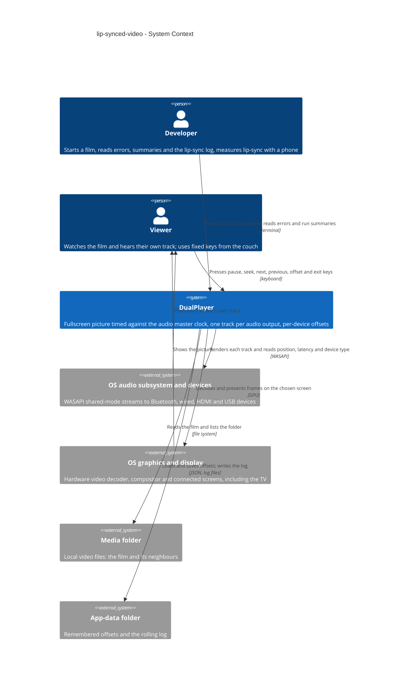

## 4. Solution strategy

**Target surfaces: `[desktop-app, cli]`.** The Viewers' surface is the fullscreen playback window (SCR-02, SCR-03). The Developer's surface is the start command in a terminal (SCR-01): arguments, plain-language errors, run summaries and exit codes. Both are hosted by one executable, `DualPlayer.App` ([ADR-0001](adr/0001-host-the-start-command-in-the-app-executable.md)). The step-3 Developer console (`DualPlayer.Console`) stays as it is.

**UI architecture (desktop-app).** An Avalonia fullscreen window (Fluent dark, MVVM with CommunityToolkit.Mvvm, compiled bindings) hosts mpv's own video output in a native child window. Viewer keys are handled by the Avalonia window, and mpv's own input is switched off. The brief note (SCR-03) is drawn by mpv's on-screen display, styled from `Themes/Tokens.axaml` ([ADR-0003](adr/0003-embed-mpv-video-output-in-a-native-child-window-and-draw-notes-with-its-osd.md)). The window has no navigation, menus or focus model: one view, three states (playing, paused, ended), per `ux-flows.md`.

**Top strategic choices (the seeds for ADRs):**

1. **Render the picture with libmpv, timed by a Core loop against the master clock** ([ADR-0002](adr/0002-render-video-with-libmpv-slaved-to-the-master-clock-behind-a-renderer-port.md)). libmpv runs in-process with its audio off and hardware decoding only (`d3d11va` on Windows, no copy-back). A new `IVideoRenderer` port exposes load, play-at, pause, seek, speed and the presented position. A Core picture-sync loop reads that position and steers mpv's `speed`, so the sync logic is tested with a fake clock (QG-1, QG-2). The master clock and mpv's own clock both run on the OS monotonic time base, so the loop mostly handles start, pause, resume, seek and the 0.2 % picture-delay moves, not long-run drift. This decision sets the direction for roadmap D1, but D1 stays open until the verification gate passes: the first task is a spike on the target PC with the kill criterion stated in ADR-0002 (§11 open question). If the spike fails, the fallback is our own FFmpeg decode-and-present path behind the same port; nothing outside `DualPlayer.Media` changes.
2. **Estimate each output's latency as the part its device position cannot see** ([ADR-0004](adr/0004-estimate-output-latency-as-the-hidden-latency-beyond-the-device-position.md)). The step-3 master clock already aligns outputs on each device's reported playback position (step-3 ADR-0008), so the OS buffer and pipeline are already compensated. The latency the player assumes is therefore the hidden part only: the latency the OS reports beyond the device position (0 ms on WASAPI today, kept as a separate logged term) plus the default for the device type. Sign convention used throughout this SAD: assumed latency `Aᵢ = reported partᵢ + type defaultᵢ − offsetᵢ`, with a positive offset making sound heard later (`CONTEXT.md` Offset). Picture delay `PD = max Aᵢ` over playing outputs; it may be negative.
3. **Hold each faster output back by a target lag inside the step-3 drift controller** ([ADR-0005](adr/0005-hold-faster-outputs-back-with-a-target-lag-moved-by-the-drift-resampler.md)). Output *i* follows `clock − Dᵢ` with `Dᵢ = PD − Aᵢ ≥ 0`. At start, the lag is part of the existing silent pre-roll alignment. During playback, a change of `Dᵢ` is a ramp at ≤ 0.2 % speed (2000 ppm) carried by the existing adaptive resampler, on top of drift correction. The picture moves at the same ≤ 0.2 % rate through mpv's `speed`. A seek, file change or resume sets the new targets at once (AC-14). `Core/Sync/` and `Core/Playback/` change, with the small step-4 edits in `Core/Diagnostics/` and `Core/Outputs/` recorded in §2 (wave note); the device enumeration of step 5 is untouched.

Each tactical decision in later sections should trace to one of these seeds. Tactical decisions that *contradict* a strategic choice are red flags — surface them in §11.

## 5. Building block view

Ports and adapters, as in every step so far ([ADR-0003](../../adr/0003-organize-code-as-core-with-platform-adapters.md)). Core gains a playback session use case and three ports: the video renderer, the device latency probe and the picture probe. The latency model, the offset book and the picture-sync loop live in Core so they are tested with a fake clock, fake devices and a fake renderer. `DualPlayer.Media` adds the libmpv renderer and the FFmpeg picture probe. Platform projects add the latency probe in new files. `DualPlayer.App` becomes the composition root that parses the start command and hosts the window. The session runs on its own control loop, a second `EngineControlLoop` instance named `"PlaybackSession"` (the step-3 loop type, two-outputs-one-clock ADR-0007), not on the engine's loop: its commands block on engine commands that run on that loop (§8). Transport commands, offset changes, device loss and picture-sync ticks are serialized on that one thread and never touch a render thread or the UI thread; only the lag ramps run on the engine's own loop. New session events travel on their own `SessionEvent` stream in `Core/Playback/`, merged with the engine events by the host. Step 4 still made small edits in `Core/Diagnostics/` (`RunEndReason` values, `RunSummaryBuilder.CarryOver`/`Merge`; see §2), which step 6 must merge with. Offsets live in their own state file ([ADR-0006](adr/0006-keep-device-offsets-in-their-own-versioned-state-file.md)). A file's picture is probed with FFmpeg before any window opens, with mpv's own hardware-decoding report as a backstop ([ADR-0007](adr/0007-probe-the-picture-with-ffmpeg-before-the-window-opens.md)).

**Internal decomposition** (new unless marked *changed*):

```
src/DualPlayer.Core/
├── Playback/
│   ├── PlaybackSession.cs        use case: start, pause/resume, seek, next/previous file, offset key, exit;
│   │                             drives IAudioEngine + IVideoRenderer on its own control loop
│   ├── SessionEvent.cs           session event stream (picture delay, latency estimate, picture timing,
│   │                             skipped frames, notes) merged with the engine events — Core/Diagnostics: only RunEndReason, RunSummary.File and RunSummaryBuilder (`Build(…, file)`) edits (§2)
│   ├── IVideoRenderer.cs         port: load, play at a timestamp, pause, seek, set speed, presented position,
│   │                             show note, frame counters, decode-failure and end events
│   ├── IPictureProbe.cs          port: has a picture? hardware-decodable on this PC? (codec, profile)
│   ├── FolderNeighbours.cs       .mkv/.mp4 in the file's folder, natural name order, skip rules (AC-07…AC-09b)
│   ├── StartRequest.cs           file, outputs (track → device), screen; validation results
│   └── AudioEngine.cs            *changed*: per-output start lag in the pre-roll release; lag targets per output; StartPosition, ContinuesPreviousRun, run-summary carry-over (§2)
├── Sync/
│   ├── LatencyModel.cs           device type → default, assumed latency Aᵢ, picture delay PD = max Aᵢ, lags Dᵢ
│   ├── DeviceType.cs             Bluetooth headphones / Bluetooth speaker / wired / HDMI / other, from connection kind + form factor
│   ├── IDeviceLatencyProbe.cs    port: reported hidden latency, connection kind, form factor per device id
│   ├── OffsetBook.cs             per-device offsets, ±500 ms clamp, 10 ms step, save ≤ 1 s after the last press
│   ├── PictureSync.cs            steers the renderer to clock − PD: start, resume, seek alignment; 0.2 % moves
│   ├── LagRamp.cs                ≤ 2000 ppm target ramp for an output's lag (ADR-0005)
│   └── DriftController.cs, OutputSync.cs, DriftMeter.cs   *changed*: error measured against clock − Dᵢ; ramp added to the ratio
├── Settings/
│   └── DeviceOffsetsFile.cs      device-offsets.json: schemaVersion 1, device id → offset ms; source-generated context
src/DualPlayer.Media/Video/
├── MpvLibrary.cs                 libmpv loading (libmpv-2.dll / Homebrew libmpv), version check, Result errors
├── MpvVideoRenderer.cs           IVideoRenderer: audio off, hwdec only, own video output into the given window handle,
│                                 input off, OSD notes, property observation on mpv's event thread
└── FfmpegPictureProbe.cs         IPictureProbe: opens the file, finds the video stream, checks hardware decoding
src/DualPlayer.Platform.Windows/Audio/WasapiLatencyProbe.cs   IDeviceLatencyProbe: enumerator / bus + form factor; hidden latency 0 ms
src/DualPlayer.Platform.MacOS/Audio/CoreAudioLatencyProbe.cs  dev-only: Core Audio transport type + device latency
src/DualPlayer.App/
├── Startup/StartCommand.cs       parse + validate the start command, exit codes, terminal output, run summary printing
├── Views/PlaybackWindow.axaml    fullscreen on the chosen screen; one view, states playing / paused / ended
├── ViewModels/PlaybackViewModel.cs   fixed key table → PlaybackSession commands; note text
├── Controls/VideoHost.cs         NativeControlHost that hands its native window handle to the renderer
└── CompositionRoot.cs            *changed*: registers session, probes, renderer; platform probe by OS
```

**C4 Container (L2):**

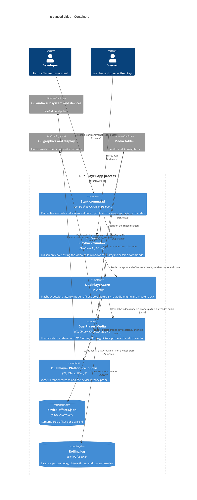

`Start command` and `Playback window` are the two declared surfaces (`cli`, `desktop-app`); both run in the one `DualPlayer.App` executable ([ADR-0001](adr/0001-host-the-start-command-in-the-app-executable.md)). `DualPlayer.Console` is not part of this feature and is not drawn.

## 6. Runtime view

Timeline used by every flow (ADR-0004, ADR-0005): output *i* has assumed latency `Aᵢ`, the picture delay is `PD = max Aᵢ`, and output *i* follows `clock − Dᵢ` with `Dᵢ = PD − Aᵢ`. Content position *p* is then heard on every output, and shown on screen, at master-clock time `p + PD`. These are seed flows; the `sequences` stage adds a flow or branch for every remaining AC (pause and resume, seek, end of film, damaged picture, last output lost).

**Critical flow 1: start a film lip-synced (US-01, US-05 — AC-01, AC-02, AC-03, AC-03b, AC-12, AC-13)**

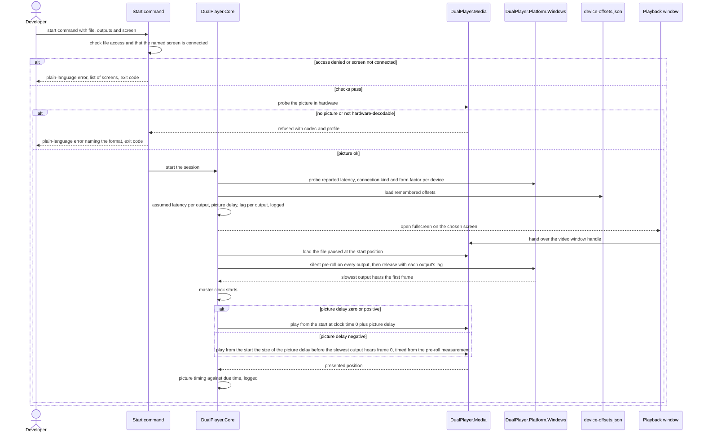

**Critical flow 2: the picture delay changes during playback (US-04, US-06 — AC-10, AC-14, AC-15)**

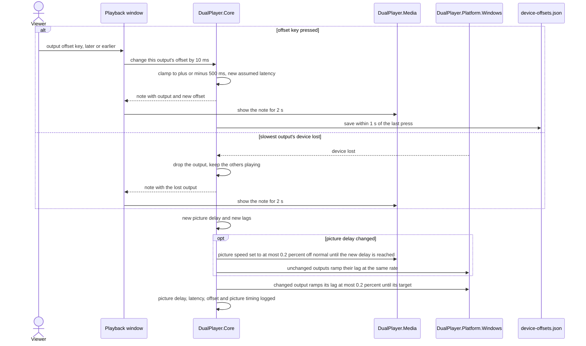

**Critical flow 3: next file, skipping files that cannot play (US-03 — AC-07, AC-08, AC-09, AC-09b)**

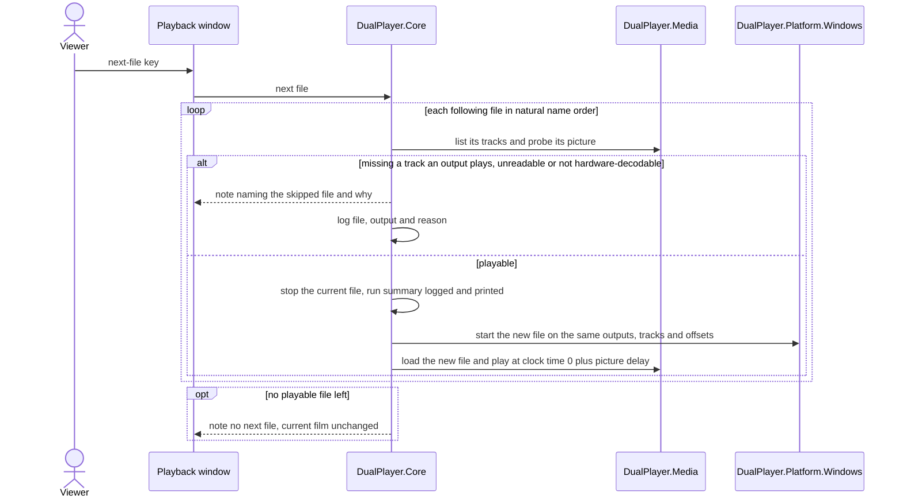

The flows below are drawn by the `sequences` stage with generic participants: `ui` is the playback window (SCR-02, SCR-03) or the start command's terminal (SCR-01); `service` is the playback session with the audio engine and the picture sync; `external-system` stands for the OS audio devices and the video renderer; `data-store` is the remembered-offsets file. Timeline as above: content position *p* is heard and shown at master-clock time `p + PD`.

### Flow 4: pause and resume (US-02 — AC-04)

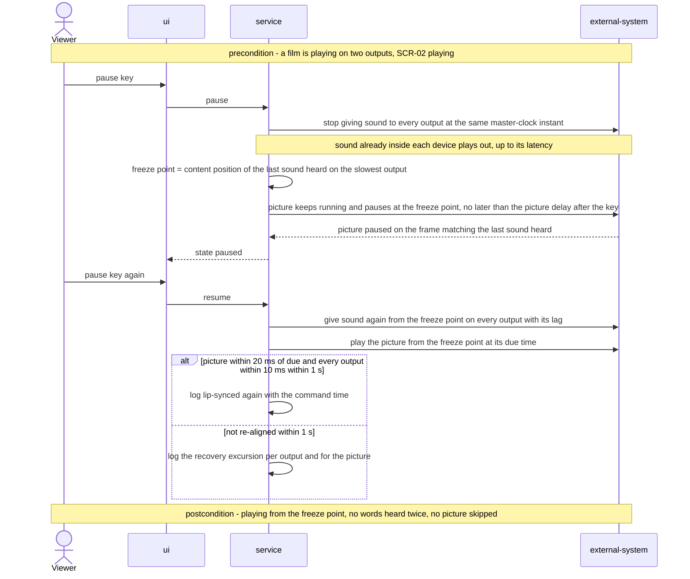

### Flow 5: seek while playing, paused or at the end (US-02 — AC-05)

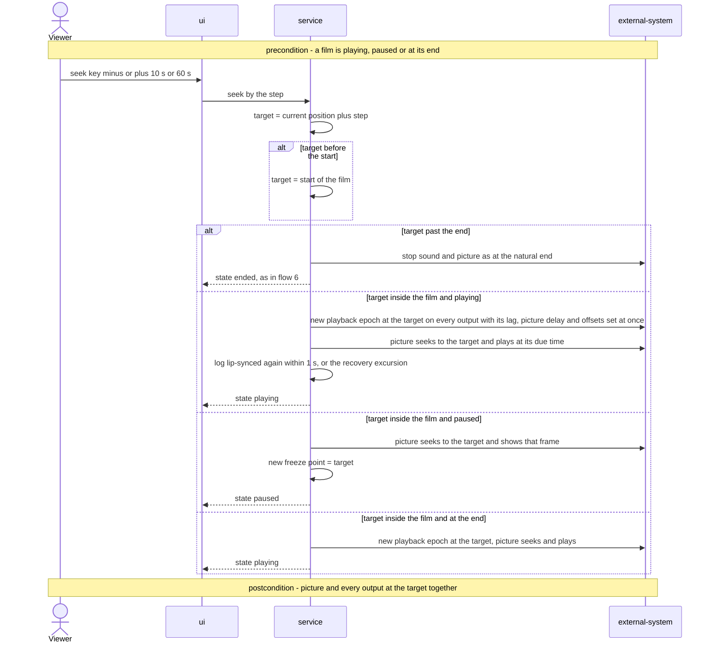

### Flow 6: end of the film, exit, and losing the last output (US-01, US-02, US-06 — AC-06, AC-15b)

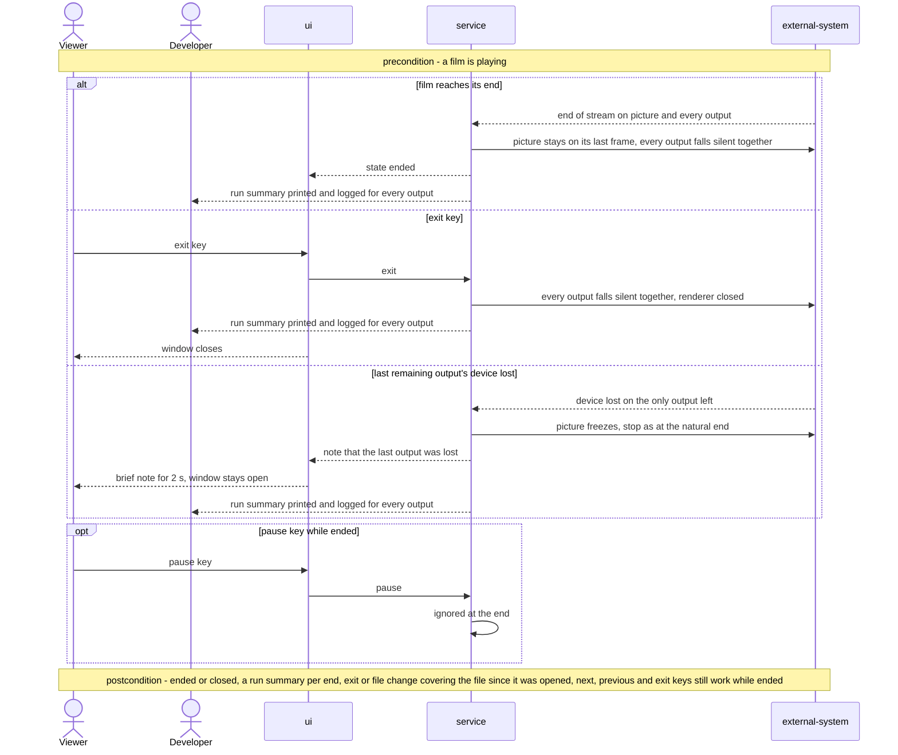

### Flow 7: damaged picture during playback (US-01 — AC-06b)

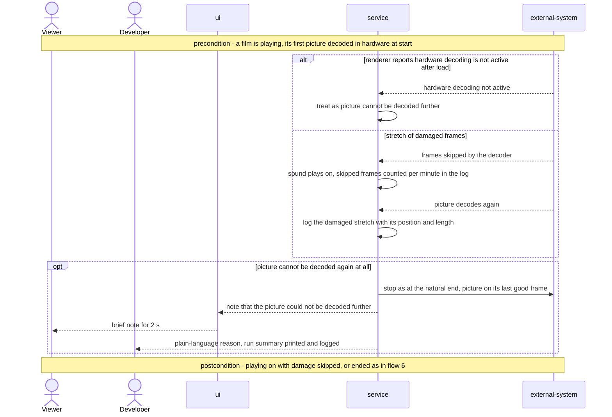

### Flow 8: offset key at the limit, while paused or ended, and saving (US-04 — AC-10, AC-11)

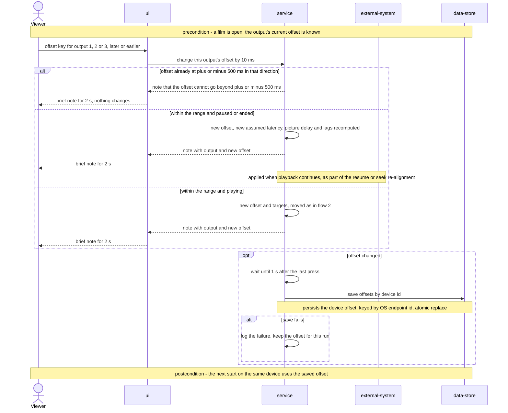

### Flow 9: lip-sync log for every change (US-07 — AC-17, AC-13)

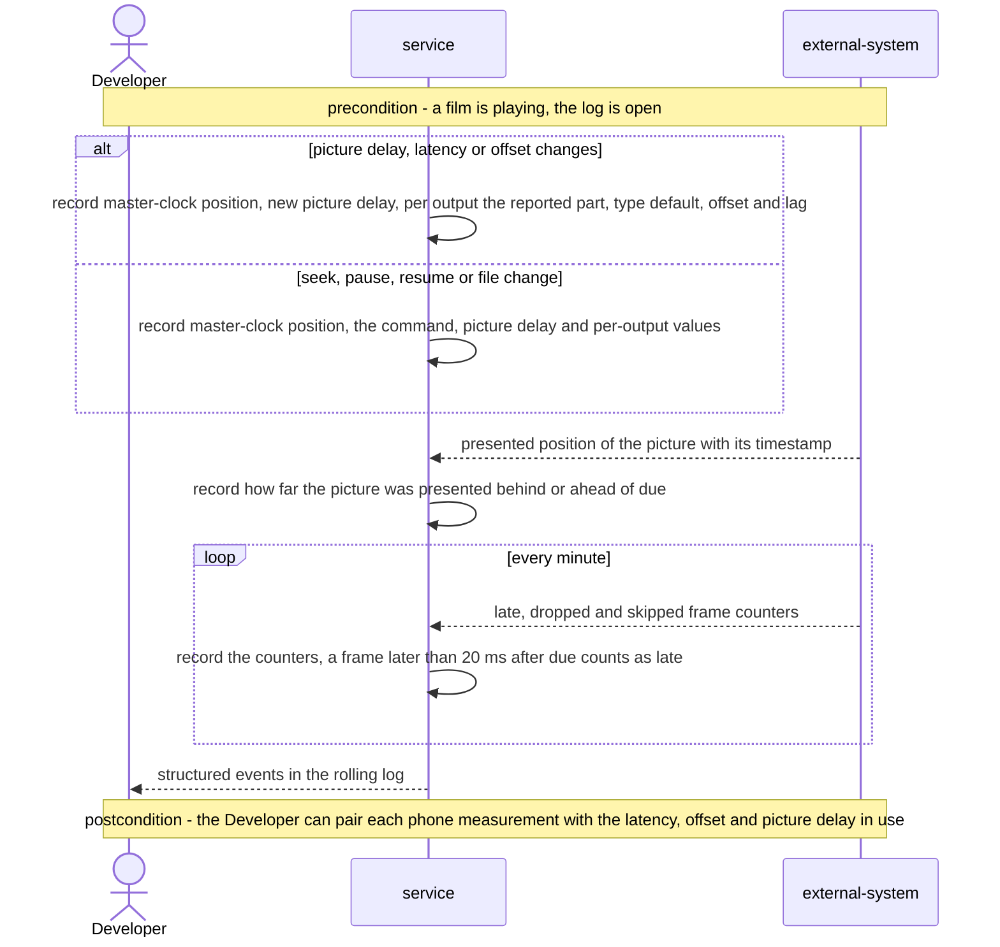

**Non-runtime:** AC-16 (the click-and-flash measurement) happens outside the player with a phone; the player's side is flow 1 starting the test video and flow 9 logging the values the evidence is paired with.

**Coverage (use cases → flows):** US-01 → flows 1, 6, 7 · US-02 → flows 4, 5, 6 · US-03 → flow 3 · US-04 → flows 2, 8 · US-05 → flow 1 · US-06 → flows 2, 6 · US-07 → flow 9 (+ AC-16 non-runtime).

**Coverage (AC → flow):** AC-01 → 1 · AC-02 → 1 (no picture branch) · AC-03 → 1 (access branch) · AC-03b → 1 (screen branch) · AC-04 → 4 · AC-05 → 5 · AC-06 → 6 · AC-06b → 7 · AC-07 → 3 · AC-08 → 3 (no playable file) · AC-09 → 3 (missing track branch, both directions) · AC-09b → 3 (unreadable or not hardware-decodable branch) · AC-10 → 2, 8 · AC-11 → 8 · AC-12 → 1 (offsets loaded) · AC-13 → 1, 9 · AC-14 → 2 · AC-15 → 2 (device lost branch) · AC-15b → 6 · AC-16 → non-runtime · AC-17 → 9.

**Flagged for later stages (not decided here):**
- Flows 1–3 (seeded by `design`) name §5 containers; flows 4–9 use generic participants. Same participants, two vocabularies.
- `sad.md` §11 rows on the offset-sign wording and on AC-13's reported part are now closed in the spec (`clarify`, 2026-11-20); the §1 decision override stays as the record of why.
- `data-model`: the only persisted entity is the device offset (flow 8), keyed by OS endpoint id in `device-offsets.json` (ADR-0006) — no database, no index.

## 7. Deployment view

One process on one PC: `DualPlayer.App` is built as a console-subsystem executable for this step (ADR-0001) and run from a terminal on the target Windows 11 PC. Native libraries sit beside the executable: the LGPL FFmpeg DLLs fetched by `build/fetch-ffmpeg.ps1` (existing) and `libmpv-2.dll` fetched by a new `build/fetch-libmpv.ps1` on the same pattern (pinned version and checksum, `build/mpv/` git-ignored, cached in CI, copied beside every referencing executable by `DualPlayer.Media.csproj`). For this step any prebuilt libmpv is acceptable for development and testing on the owner's PCs, where nothing is distributed. An LGPL build (`-Dgpl=false`) replaces it before roadmap step 13 packages the player (§11). On the dev Mac, libmpv and FFmpeg come from Homebrew (`brew install mpv ffmpeg@8`); CI's macOS job installs both. No network, no service, no replicas; packaging and the installer are roadmap step 13.

**Monitoring** (local log, `ILogger` → Serilog rolling file in `%APPDATA%/DualPlayer/logs/`):
- Metrics — per start: each output's device, type taken, reported part, type default, offset, assumed latency, lag and the picture delay (AC-13, AC-12). On every change of picture delay, latency or offset, and on seek, pause, resume or file change: master-clock position, new picture delay, per-output split, and picture presented-vs-due error (AC-17). mpv's late and dropped frame counters as a per-minute record, and skipped damaged frames (AC-06b). The step-3 sync records and run summary continue unchanged.
- Alerts — none (single-user desktop program). A start error, a refused file, a lost device and a picture that cannot be decoded further are written to the terminal and the log in plain words (AC-02, AC-03, AC-03b, AC-06b, AC-15).
- Tracing — the start timestamps that measure the 3 s budget: start command, first frame presented, first audio heard per output (spec §6).
- Acceptance evidence — the spike results (ADR-0002), the click-and-flash measurements per output (AC-16) and the CPU average from the OS performance counter go to `docs/features/lip-synced-video/evidence/`.

**Scaling thresholds:**
- Outputs: at most three per run (spec §5 key table); the per-output lag ramps run on the engine control loop and scale linearly.
- Folder size: next and previous list and naturally sort the folder on each key press. Thousands of files must still answer within the start budget (spec §6.1). The probe runs only on the file being moved to, plus each skipped file on the way. Both the track listing and the picture probe take a `CancellationToken` that the FFmpeg adapters check in an `AVIOInterruptCB`; the session cancels it when it gives up on a file (budget out, or the probe used up its limit), so an abandoned worker returns promptly and closes the file at the next I/O boundary (`FfmpegPictureProbe` also cancels its own worker when its limit runs out). FFmpeg calls the callback only between I/O calls, so a read blocked inside the OS (a dead SMB share, a failing disk) cannot be broken: that worker keeps its thread and the file open until the OS gives up, and the session does not wait for it. The step-past memory bounds how many such threads can pile up: the abandoned worker task is kept per file key and a later press steps past that file (counted as checked, reason `unreadable`) without starting a new worker until the task completes, so at most one blocked thread per file. The 3 s budget counts from the start of the command plus any queue wait. The session remembers the files it gave up on (including a file that had the press's whole budget and still could not be judged) and steps past them on the next press in the same direction; remembered files passed over before the chosen target are published as skipped; the set is cleared on a successful file change (spec §6.1, cli.md §2.2).
- Log size: Serilog's existing 20 MB file limit with 10 retained files bounds a 2 h film's per-minute frame records and change events.

## 8. Crosscutting concepts

| Concept | Convention | Where defined |
|---|---|---|
| Logging | `ILogger<T>` everywhere; Serilog rolling file under app-data `logs/`. New structured events from the `SessionEvent` stream: latency estimated (per output: device, type taken, reported part, type default, offset, assumed latency, lag), picture delay changed, picture timing (presented vs due), per-minute frame counters (late, dropped, skipped damaged). The App host writes engine and session events to the log and prints the run summary to the terminal | `CLAUDE.md` Logging; here (event set); step-3 ADR-0007 (stream model) |
| Authentication / authorization | N/A — local single-user program. The only access checks are the OS's own file and device access (AC-03, step-3 AC-04) | spec §6.1 |
| Error handling | Expected failures are `Result` / `Result<T>` with dotted lowercase codes, e.g. `playback.file_access_denied`, `start.screen_not_found`, `video.no_picture`, `video.not_hardware_decodable`, `video.decode_failed`, `mpv.not_found`, `mpv.load_failed`; device loss and picture decode failure during play are session events. Exceptions are bugs, logged at the top of each loop. Exit codes and the exact message text are fixed by `contracts/cli.md` (api stage) | `CLAUDE.md` Errors; `src/DualPlayer.Core/Result.cs` |
| Time and clocks | All lip-sync arithmetic is in Core on the master clock and `TimeProvider`; no `DateTime.Now` / `Stopwatch` in Core. The mpv adapter converts mpv's timestamps to the same monotonic time base the step-3 backend uses (QPC on Windows) before handing them to Core | `CLAUDE.md` Time and clocks; ADR-0002 |
| Threading | The playback session runs on its own control thread (a second `EngineControlLoop` instance): every command, timer callback, engine event and renderer event is handled there one at a time in posting order. It is not the engine control loop itself because the session's commands block on engine commands (pre-roll, seek confirmation) that run on that loop; events and timers only post, so nothing waits in a cycle (T24, review-2026-11-20 F7). The App queues each key's command on a third thread, so the UI never waits. Lag ramps run on the step-3 engine control loop. mpv property and end events arrive on mpv's event thread; the adapter publishes immutable snapshots without locks the control loop could wait on. Render threads are never blocked. UI updates marshal through `Dispatcher.UIThread`. The picture probe runs off the UI thread with a time limit | `CLAUDE.md` Threading; step-3 ADR-0007 |
| Persistence | `device-offsets.json` through `IStateStore`, atomic temp + rename, `schemaVersion` 1, source-generated context; saved ≤ 1 s after the last offset press; values clamped to ±500 ms and rounded to 10 ms on load, each clamp logged | ADR-0006; project ADR-0004 |
| ID strategy | Devices keyed by OS endpoint id string; media files by normalized absolute path + size + mtime | `CLAUDE.md` IDs |
| Units and sign | Offsets are integer milliseconds, step 10, range −500…+500; a positive offset makes sound heard later. Assumed latency `Aᵢ = reported part + type default − offset`; picture delay `PD = max Aᵢ` may be negative; lag `Dᵢ = PD − Aᵢ ≥ 0`. Type defaults (spec §8): Bluetooth headphones 200 ms, Bluetooth speaker 200 ms, wired 0 ms, HDMI 0 ms, other 0 ms, kept in one table in `Core/Sync/LatencyModel` | ADR-0004; here |
| mpv hardening | mpv starts with no user config, no scripts, no on-screen controller, no default key bindings, no keyboard on its video output, no network helpers, audio off, and hardware decoding only (no copy-back, no software fallback): `config=no`, `load-scripts=no`, `osc=no`, `input-default-bindings=no`, `input-vo-keyboard=no`, `ytdl=no`, `audio=no`, `keep-open=yes` (the picture stops on the last frame at the end of the film and a seek past it shows that frame), `force-window=yes` (the window stays up after an error end-of-file, so the last good frame and the picture-failed note stay visible, AC-06b), `hwdec=d3d11va` on Windows | spec §6.1; ADR-0002, ADR-0003 |
| UI and on-screen note | The note's font size, colours and margins come from `Themes/Tokens.axaml` (body ≥ 32 px, contrast ≥ 7:1) and are passed to mpv's OSD; held 2 s after the last change, a new note replaces the current one | `CLAUDE.md` UI; ADR-0003; `ux-flows.md` |
| Internationalisation | English messages in this step; the Ukrainian UI is roadmap step 8 | roadmap |
| Testing | xUnit v3 + Shouldly + NSubstitute. Core logic with a fake clock, fake devices (`EngineRig`), and new `FakeVideoRenderer`, `FakeDeviceLatencyProbe`, `FakePictureProbe`. The libmpv adapter and the FFmpeg probe with sample files; tests needing a GPU, a screen or audio hardware use `[HardwareFact]` | `CLAUDE.md` Tests |

## 9. Architecture decisions

| # | Title | Status | Section |
|---|---|---|---|
| 0001 | Host the start command in the App executable | Accepted | §4 |
| 0002 | Render video with libmpv slaved to the master clock behind a renderer port | Accepted | §4 |
| 0003 | Embed mpv's video output in a native child window and draw notes with its OSD | Accepted | §4 |
| 0004 | Estimate output latency as the hidden latency beyond the device position | Accepted | §4 |
| 0005 | Hold faster outputs back with a target lag moved by the drift resampler | Accepted | §4 |
| 0006 | Keep device offsets in their own versioned state file | Accepted | §5 |
| 0007 | Probe the picture with FFmpeg before the window opens | Accepted | §5 |

ADR files live under `docs/features/lip-synced-video/adr/`, one file per decision, named `NNNN-decision-in-kebab-case.md`. Project-wide ADRs live under `docs/adr/`; step-3 ADRs under `docs/features/two-outputs-one-clock/adr/`.

## 10. Quality requirements

All scenarios apply to the target Windows 11 PC under the step-3 conditions: two Bluetooth headsets in the same room as the PC, in line of sight, plus optionally one wired or HDMI output (spec §6). The macOS development path is not held to them.

**QG-1. Lip-sync per output**
- **When:** a click-and-flash test video (a white flash and a click on every output at the same moment, once per second) plays on the target PC with both Bluetooth headsets and one wired or HDMI output, after the Viewers' offsets are set.
- **Then:** on every output, sound is no more than 45 ms ahead of and no more than 125 ms behind its picture (ITU-R BT.1359 detectability).
- **How verify:** AC-16 procedure — film with a phone at ≥ 120 frames per second, subtract the phone's own offset measured from a hand clap, 10 flashes per output, the largest error counts. Record it in `evidence/` with the latency, offset and picture delay the player logged (AC-17). Unit tests with a fake clock check that `PD = max Aᵢ` and `Dᵢ = PD − Aᵢ` put every output's heard time on the picture's due time.

**QG-2. Seamless changes and fast recovery**
- **When:** (a) the picture delay changes during playback because an offset is corrected or the slowest output's device is lost; (b) a Viewer pauses, resumes or seeks; (c) the Developer gives the start command, or a Viewer changes file.
- **Then:** (a) picture and unchanged outputs move together at ≤ 0.2 % speed change (about 5 s per 10 ms of change), each within the lip-sync budget throughout; (b) picture and every output are lip-synced again ≤ 1 s after the key press (3 s for a `return`, a backward seek at the end that returns into the film, as for a start or a file change), where "lip-synced again" means the picture is presented within 20 ms of due and every output is within 10 ms of its due position; (c) start command to picture and sound ≤ 3 s, picture and every output together, and a file change is lip-synced within the start budget.
- **How verify:** (a) log of picture presentation against due time and of playback speed, plus unit tests with a fake clock and fake renderer for the ramp rate and the lag targets; (b) log of the key's arrival (timing counts from the key press, so the wait in the command queue and the engine's own wait are included), the first picture presentation within 20 ms of due, and each output's position error, plus unit tests with a fake clock; (c) log timestamps of start command, first frame presented and first audio heard per output (logged as first sound given plus assumed latency). The ADR-0002 spike checks (a) and (b) on the target PC before the rest of the step is built.

**QG-3. Smooth picture at low cost**
- **When:** a 2 h 1080p H.264 film and a 2 h 1080p HEVC film play with hardware decoding on two outputs.
- **Then:** ≤ 1 frame presented late or dropped per minute, averaged over the 2 h film; CPU ≤ 15 % of total CPU while playing the 1080p HEVC film on two outputs.
- **How verify:** the renderer's late and dropped frame counters, logged per minute, averaged over the run; the operating-system performance counter, average over the run, recorded in `evidence/`.

**QG-4. Offsets are remembered and bounded** (supporting goal)
- **When:** a Viewer presses an output's offset keys, and the player or the PC is later stopped or crashes, or the offsets file is edited by hand.
- **Then:** offsets move in 10 ms steps within −500 to +500 ms per output, are saved no later than 1 s after the last press, and the next start on the same device uses them; out-of-range values in the file are clamped to ±500 ms and logged.
- **How verify:** unit tests for the offset book (step, range, clamp, debounce with a fake clock); an integration test that presses, waits 1 s on the fake clock, abandons the session with no orderly shutdown, and reloads through a fresh `JsonFileStateStore`.

## 11. Risks and technical debt

| Risk / debt | Severity | Mitigation | Owner |
|---|---|---|---|
| libmpv steered through `speed` and `seek` may not hold the picture within 20 ms of due, or may show a 0.2 % move as a jump (roadmap D1) | High | The first task is a spike on the target PC with the kill criterion in ADR-0002. On failure, an own FFmpeg decode-and-present adapter behind the same `IVideoRenderer` port. A failed spike means re-sizing the step to XL, a superseding ADR, a repeated design pass for the Media part, and an updated roadmap status | Volodymyr Kravchuk |
| Device-type defaults (Bluetooth 200 ms, others 0 ms) are unmeasured. Whether a Bluetooth device's reported position already includes part of its codec latency is still open (spec §8, due before design); this SAD adopts the spec default "not included" (ADR-0004) | High | Until measured, use the spec §8 defaults. Measure every device type with the AC-16 procedure once the player is built, record in `evidence/`, and revise the defaults after acceptance and before roadmap step 8 is specified (spec §7). Move the spec §8 due date in the same `/sdd:clarify` pass. The defaults live in one table in `LatencyModel` | Volodymyr Kravchuk |
| The start budget of ≤ 3 s is tight. The step-3 start already takes ~2 s with the MOTIF headset (silent pre-roll, step-3 ADR-0008), and this step adds the picture probe and mpv's file load | Medium | Run the picture probe and the device latency probe before the pre-roll. Load the file in mpv while the pre-roll runs. Log each phase's timestamps; the spike measures them | Volodymyr Kravchuk |
| Spec wording disagrees on the offset sign. `CONTEXT.md` and AC-10 say a positive offset is heard later, while AC-10 and the Picture-delay glossary entry also speak of "latency plus offset below zero" and "sound given ahead of the picture" | Medium | This SAD fixes `Aᵢ = reported part + type default − offset` and `PD = max Aᵢ` (§8, ADR-0004). Patch the spec and glossary wording with `/sdd:clarify` before `/sdd:tasks` | Volodymyr Kravchuk |
| On Windows the "OS-reported" part of the latency estimate is 0 ms (ADR-0004), so AC-13's estimate is the type default alone | Medium | Kept as a separate logged term; the spec's AC-13 wording is aligned in the same `/sdd:clarify` pass; step 12 (automatic measurement) refines the estimate | Volodymyr Kravchuk |
| Ramping an output's lag widens the resampler's ratio range from ±500 ppm to about ±2500 ppm, and a ramp can be mistaken for drift in step-3 metrics (ADR-0005) | Medium | Drift is measured against the moving target and the ramp is logged as its own event; listen for artefacts on the target PC during the spike; unit tests check that a ramp adds no correction or excursion to the run summary | Volodymyr Kravchuk |
| Avalonia cannot draw over mpv's native child window (airspace, ADR-0003), and roadmap step 8 needs a bar and output tiles over the video | Medium | Step 8 decides between a transparent top-level overlay window and mpv's OSD; resolve in step 8's design | Volodymyr Kravchuk |
| The native video child window may take keyboard focus from the Avalonia window, so keys stop working | Medium | mpv input off (`input-default-bindings=no`, `input-vo-keyboard=no`); the child window is created non-focusable; the spike checks every key in the spec §5 table | Volodymyr Kravchuk |
| The TV's own picture-processing delay is invisible to the PC and shifts every output by the same amount (spec §8) | Medium | Not modelled; the Viewers' offsets absorb it; a single screen offset is left to step 8 | Volodymyr Kravchuk |
| Prebuilt Windows libmpv builds are usually GPL; the project ships LGPL only | Medium | `build/fetch-libmpv.ps1` pins a build; an LGPL build (`-Dgpl=false`) replaces any GPL one before roadmap step 13 packages the player; no distribution until then (§7) | Volodymyr Kravchuk |
| Parallel wave 4 ∥ 5 ∥ 6: `AudioEngine.cs` and `CompositionRoot.cs` may also be touched by steps 5 or 6. Step 4 also adds new files outside its roadmap zone: `Platform.Windows/Audio/WasapiLatencyProbe.cs` (next to step 5's enumeration) and `Core/Settings/DeviceOffsetsFile.cs` | Low | Step 4 went beyond the lag hooks: `Core/Diagnostics/` (`EngineEvent.cs`, `RunSummaryBuilder.cs`), `Core/Outputs/IDeviceAccessProbe.cs` + `BackendDeviceAccessProbe.cs` and `AudioEngine` (`StartPosition`, `ContinuesPreviousRun`, summary carry-over), and in existing files `Error.Fields` in `Core/Result.cs`, the flush before rename and the temp-file test seam in `Core/Settings/JsonFileStateStore.cs` (T54), the cancellation-token overloads on `IAudioDecoder` and `IPictureProbe`, `IVideoRenderer.Load(…, timeout)`, `OutputLatency.IsLost` and the new session events, plus the Core registrations `IOutputLagControl`, `OffsetBook` and `PlaybackSession` in `Core/CoreServiceCollectionExtensions.cs` — recorded in §2; steps 5 and 6 must merge with these. Update the roadmap's wave-3 zone line for step 4. Merge order follows the roadmap waves | Volodymyr Kravchuk |
| Two FFmpeg builds (ours for the probe, libmpv's for playback) may disagree about a codec or profile (ADR-0007) | Low | mpv's `hwdec-current` backstop turns a disagreement into a picture decode error or a skipped file, never software playback | Volodymyr Kravchuk |
| The primary texts of ITU-R BT.1359 and EBU R37 are still unread (spec §8); the 45 / 125 ms limits come from search summaries | Low | Use 45 and 125 ms as in spec §6; confirm the primary text before the acceptance measurement | Volodymyr Kravchuk |
| Open architectural decision: roadmap D1 — does libmpv steered by the Core loop meet the ADR-0002 kill criterion on the target PC? | Open question | Resolve before any task after the spike in `/sdd:implement`; the direction (libmpv) is chosen, the verification is pending | Volodymyr Kravchuk |
| `docs/architecture-map.md` is stale: it still describes the pre-scaffold plan (reflects `546fd39`), not the code after step 3 | Low | Run `/sdd:survey` to refresh it before the next design; this SAD used a fresh scan (§3) | Volodymyr Kravchuk |

**Accepted debt (acceptable in v1, plan to fix later):**
- `DualPlayer.App` is a console-subsystem executable, so a double-click opens a console window (ADR-0001); revisit when step 8/13 make App the Viewers' entry point.
- Engine events and session events are two streams merged by the host (§5); step 6 may fold them together in `Core/Diagnostics/`.
- The latency estimate's reported part is 0 ms on Windows (ADR-0004); step 12's automatic measurement is the planned replacement for type defaults.
- Development builds may use a GPL libmpv until step 13 (§7).
- The picture's presented-vs-due figure is an estimate from mpv's reports, not a swapchain statistic (ADR-0002); the phone measurement (AC-16) is the ground truth.

## 12. Glossary

Terms from [`CONTEXT.md`](../../../CONTEXT.md) are canonical; terms marked ✱ surfaced in this SAD and are not in `CONTEXT.md` yet (candidates for `/sdd:glossary`).

| Term | Meaning |
|---|---|
| Audio output | One listening channel: a track played on a device with its own offset (`CONTEXT.md`). At most three per run in this step |
| Device | An audio endpoint the OS exposes, keyed by its endpoint id (`CONTEXT.md`) |
| Device type | The latency class a device is taken as — Bluetooth headphones, Bluetooth speaker, wired, HDMI or other — from the connection kind and form factor the OS reports, never from the name (`CONTEXT.md`) |
| Latency | The fixed time between handing a sound to a device and the Viewer hearing it (`CONTEXT.md`) |
| Hidden latency ✱ | The part of a device's latency its reported playback position does not show (Bluetooth codec and headset, a TV's audio processing). The only latency this step compensates, because the step-3 master clock already aligns outputs on reported positions (ADR-0004) |
| Reported part ✱ | The hidden latency the OS itself reports for a device beyond its playback position; 0 ms on WASAPI today, kept as a separate logged term (ADR-0004) |
| Type default | The latency assumed for a device type until measured: Bluetooth headphones 200 ms, Bluetooth speaker 200 ms, wired 0 ms, HDMI 0 ms, other 0 ms (spec §8) |
| Offset | A Viewer's manual correction per device, −500…+500 ms in 10 ms steps; a positive offset makes the output's sound heard later (`CONTEXT.md`) |
| Assumed latency ✱ (`Aᵢ`) | The latency the player works with for output *i*: reported part + type default − offset |
| Picture delay (`PD`) | How far the picture is held back behind the master clock to line up with the slowest output: `max Aᵢ`; may be negative (`CONTEXT.md`) |
| Lag ✱ (`Dᵢ`) | How far output *i* follows behind the master clock so that it lines up with the picture: `PD − Aᵢ ≥ 0`; changed by a ramp at ≤ 0.2 % speed (ADR-0005) |
| Master clock | The single playback timeline every output follows; it never depends on one device (`CONTEXT.md`) |
| Drift / Correction | An output's slow movement away from the master clock, and the engine's response to it (`CONTEXT.md`); a lag ramp is neither |
| Picture sync ✱ | The Core loop that keeps the presented picture at `clock − PD` by steering the renderer's speed and seeking for large errors (ADR-0002) |
| Brief note | The on-screen message held 2 s after the last change (spec §5, SCR-03), drawn by mpv's OSD (ADR-0003) |
| Run summary | The per-output account of one run, printed and logged when playback stops (`CONTEXT.md`) |
| Developer / Viewer | The person who starts and measures the player / the people who watch and listen (`CONTEXT.md`) |
| Spike / kill criterion ✱ | The first implementation task: a short prototype on the target PC with measurable pass/fail limits that decide whether libmpv stays (ADR-0002) |

