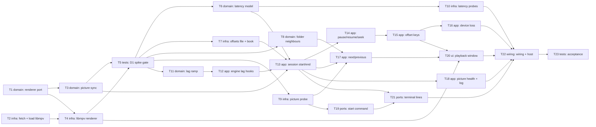

# Epic — lip-synced-video

> **Spec:** [spec.md](../spec.md) · **Design:** [sad.md](../sad.md) · **Data model:** [data-model.md](../data-model.md) · **API:** [cli.md](../contracts/cli.md) (no OpenAPI — `target_surfaces: [desktop-app, cli]`) · **Screens:** [screens.md](../screens.md) · **ADRs:** [adr/](../adr/)

## Goal

Each Viewer hears their own track in step with the lips on a fullscreen picture, on any mix of Bluetooth, wired and HDMI devices, and controls pause, seek, next/previous file and a per-device offset from the couch (spec §2). The step is accepted on the target Windows PC by filming a click-and-flash video per output (spec §2, §7).

## Scope

- **In:** `Core/Playback/` (session, ports, folder neighbours, engine lag hooks), `Core/Sync/` (latency model, offset book, picture sync, lag ramp), `Core/Settings/` (new `device-offsets.json`), `DualPlayer.Media/Video/` (libmpv renderer, FFmpeg picture probe), new latency-probe files in both platform projects, `DualPlayer.App` (start command, playback window, terminal printer, composition root), `build/fetch-libmpv.ps1`, CI.
- **Out:** couch UI, configurable keys, playlist/auto-advance/resume, device and track pickers, automatic latency measurement, TV picture delay, software decoding (spec §3); no edits to `Core/Outputs/`, `Core/Diagnostics/`, existing `Platform.Windows` enumeration or `DualPlayer.Console` (sad §2, §5).

## Task map

T5 is the ADR-0002 verification gate (roadmap D1): every task after it depends on it, as spec §8 requires.

## Tasks

See [tracker.md](./tracker.md) for status. Machine contract: [tasks.json](../tasks.json).

| # | Task | Layer | Blocked by | DoD (short) |
|---|---|---|---|---|
| T1 | [Define the IVideoRenderer port and a scripted fake renderer in Core](./T1-define-the-video-renderer-port.md) | domain | — | fake renderer tests pass |
| T2 | [Fetch a pinned libmpv, copy it beside the executables, and load it with a version check](./T2-fetch-and-load-libmpv.md) | infra | — | missing/old libmpv → Result error; CI has libmpv |
| T3 | [Steer the picture to clock minus picture delay with a Core picture-sync loop](./T3-picture-sync-loop.md) | domain | T1 | ≤ 20 ms steady, ≤ 1 s realign, 0.2 % moves (fake clock) |
| T4 | [Implement the hardened libmpv video renderer with presented-position snapshots and OSD notes](./T4-libmpv-video-renderer.md) | infra | T1, T2 | hardened options; plays, seeks, reports position |
| T5 | [Spike libmpv precision on the target PC against the ADR-0002 kill criterion and record the D1 verdict](./T5-spike-libmpv-precision-on-the-target-pc.md) | tests | T3, T4 | kill-criterion verdict in evidence/, roadmap D1 |
| T6 | [Model device types, type defaults, assumed latency, picture delay and lags behind a latency-probe port](./T6-latency-model-and-device-types.md) | domain | T5 | AC-13 type mapping; Aᵢ, PD, Dᵢ arithmetic |
| T7 | [Persist per-device offsets in device-offsets.json and keep them in an offset book with clamp, step and debounced save](./T7-device-offsets-file-and-offset-book.md) | infra | T5 | clamp, step, save ≤ 1 s, reload after abandon |
| T8 | [List a file's folder neighbours (.mkv/.mp4) in natural name order for next and previous](./T8-folder-neighbours-in-natural-order.md) | domain | T5 | natural order, .mkv/.mp4, 10 000 files < 1 s |
| T9 | [Probe a file's picture with FFmpeg in hardware, off the caller's thread, with a time limit](./T9-ffmpeg-picture-probe.md) | infra | T5 | each probe error code; time limit holds |
| T10 | [Report each device's connection kind, form factor and hidden latency on Windows and the dev Mac](./T10-device-latency-probes.md) | infra | T6 | OS facts → connection kind; hidden 0 ms on WASAPI |
| T11 | [Measure each output's drift against clock minus its lag and ramp lag changes at up to 2000 ppm](./T11-lag-ramp-in-the-drift-controller.md) | domain | T5 | ≤ 2000 ppm ramp; drift against clock − Dᵢ |
| T12 | [Give the audio engine per-output start lags in the pre-roll and lag targets that ramp or jump](./T12-engine-lag-hooks.md) | app | T11 | lags in pre-roll; ramps; IAudioEngine unchanged |
| T13 | [Start a lip-synced playback session, end it at the natural end or on exit, and emit session events](./T13-playback-session-start-end-exit.md) | app | T3, T6, T7, T12 | lip-synced start ±PD; end and exit summaries |
| T14 | [Pause, resume and seek picture and every output together in the session](./T14-session-pause-resume-seek.md) | app | T13 | AC-04/AC-05 branches on the fake clock |
| T15 | [Apply offset keys per output and move picture and unchanged outputs to a new picture delay together](./T15-session-offset-keys-and-picture-delay-moves.md) | app | T14 | AC-10/AC-11 + PD moves at ≤ 0.2 % |
| T16 | [Keep playing when an output's device is lost, and end the film when the last one is lost](./T16-session-device-loss.md) | app | T15 | AC-15/AC-15b |
| T17 | [Move to the next or previous playable file in the folder, skipping files that cannot play](./T17-session-next-and-previous-file.md) | app | T8, T9, T13 | AC-07…AC-09b skips and notes |
| T18 | [Skip damaged frames, end on an unrecoverable picture, and log picture timing and frame counters](./T18-damaged-picture-and-lip-sync-log.md) | app | T13 | AC-06b end; PictureTiming/FrameCounters cadence |
| T19 | [Parse and validate the play start command in the App executable before any window opens](./T19-start-command-parse-and-validate.md) | ports | T9 | pre-start errors, order, exit codes |
| T20 | [Build the fullscreen playback window hosting mpv's video, mapping the fixed keys and styling notes from tokens](./T20-playback-window-keys-and-notes.md) | ui | T4, T15, T17 | keys → commands; notes styled from tokens |
| T21 | [Print start lines, warnings, running lines and run summaries to the terminal and the log](./T21-terminal-lines-and-run-summaries.md) | ports | T13, T19 | cli.md lines and run summaries |
| T22 | [Wire the App composition root and host: validate, open the window on the screen, run the session, exit with the right code](./T22-wire-the-app-composition-root-and-host.md) | wiring | T10, T16, T18, T20, T21 | smoke test; dev-Mac run exits 0 |
| T23 | [Measure lip-sync per output on the target PC with a click-and-flash video and record the acceptance evidence](./T23-measure-lip-sync-on-the-target-pc.md) | tests | T22 | AC-16 evidence per output on target PC |

## Risks / Hard rules

- **D1 gate:** no task after T5 starts until the spike passes the ADR-0002 kill criterion; on failure a superseding ADR and re-size to XL (spec §8, sad §11).
- **Core stays pure:** BCL + `Microsoft.Extensions.*.Abstractions` only; no `DateTime.Now` / `Stopwatch` in Core (sad §2).
- **Parallel wave 4 ∥ 5 ∥ 6:** no edits to `Core/Outputs/` or the `Platform.Windows` device enumeration; engine changes confined to the lag hooks; `IAudioEngine` unchanged so `DualPlayer.Console` stays untouched (sad §2, §11).
- **Errors as `Result` / events**, never thrown across modules; exit codes and messages per `contracts/cli.md` (sad §2, §8).
- **Threading:** session, picture sync and lag ramps on the engine control loop; render threads never blocked; UI via `Dispatcher.UIThread` (sad §8).
- **LGPL:** libmpv and FFmpeg dynamically linked; GPL libmpv only for local dev until step 13 (sad §2, §7, §11).
- **Sign convention:** `Aᵢ = reported + type default − offset`, `PD = max Aᵢ` (may be negative), `Dᵢ = PD − Aᵢ ≥ 0` (ADR-0004, sad §8).
- **Deferred spike checks:** key focus with the native child window and resampler artefacts at ±2500 ppm cannot be checked in T5 (no window, no lag ramps yet) — T22/T23 check them.
