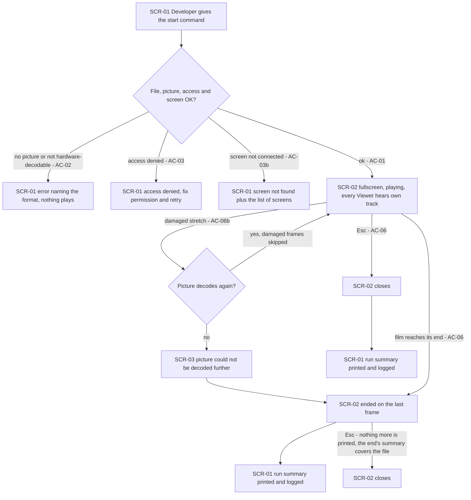
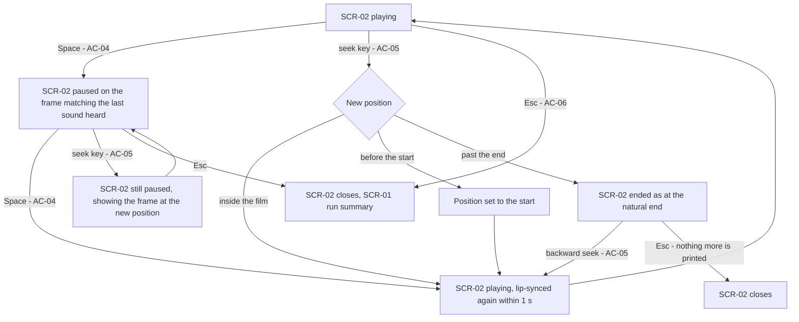
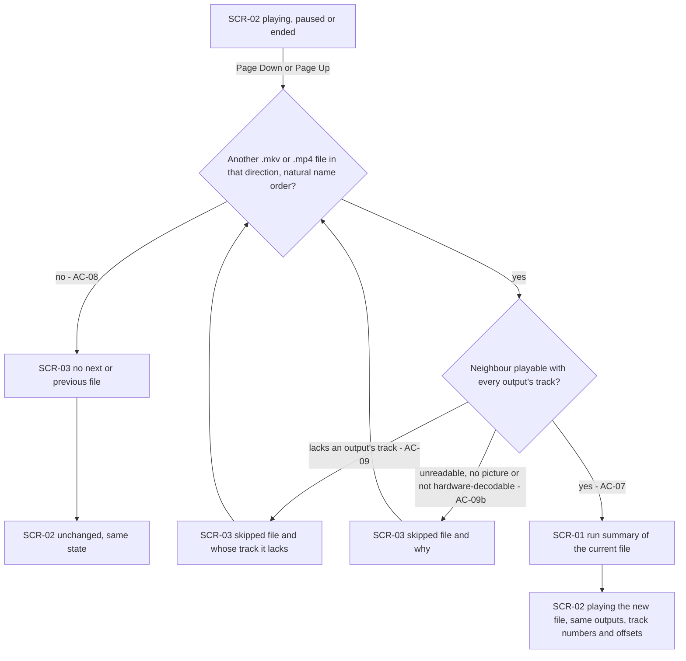
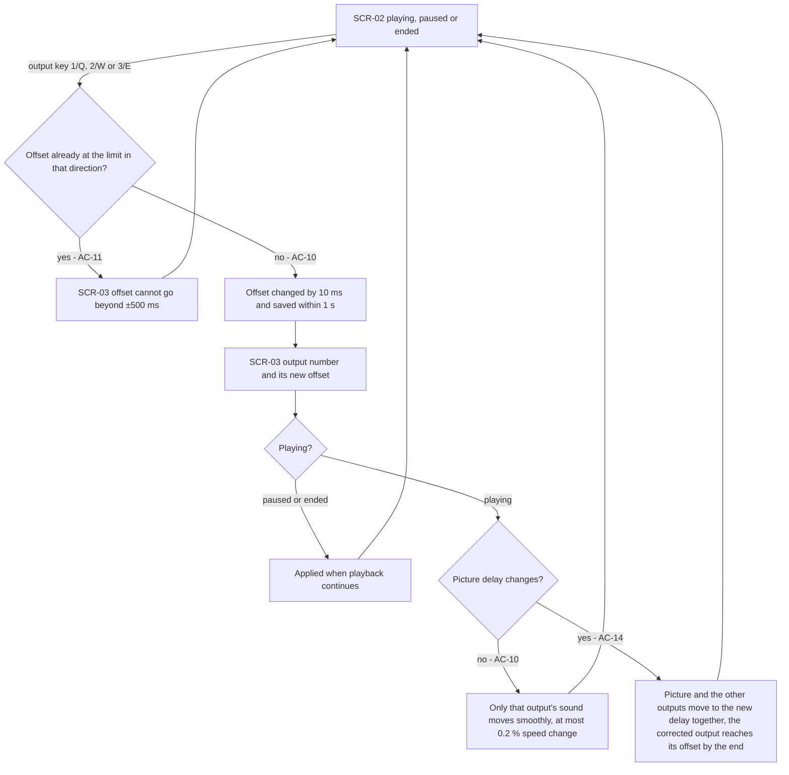
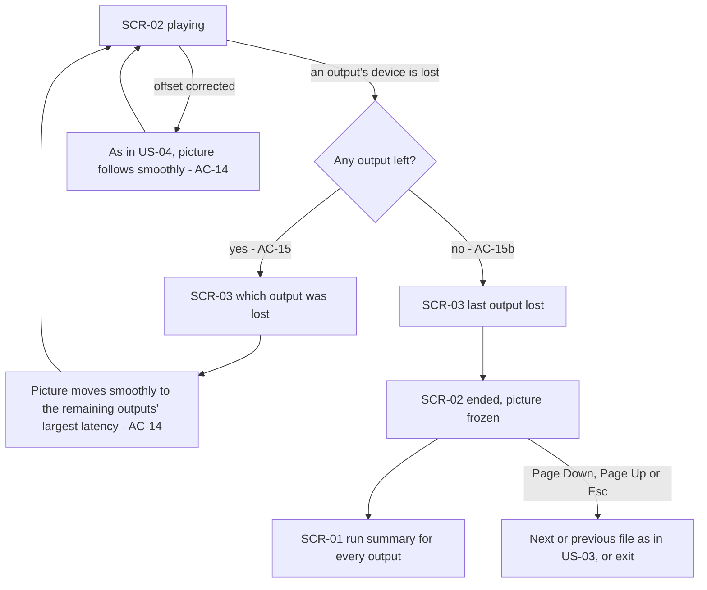

# UX flows — lip-synced-video

> User flows for every UI-touching §4 user story, produced by `ux-flows` (after `clarify`, before
> `design`) and read by `design` (evidence for the target-surface + UI-architecture decisions),
> `sequences` (UI-driven flows align on SCR ids), `screens` (details every inventory row) and
> `plan-tests` (the e2e-through-UI paths). **Always markdown + mermaid `flowchart`**, whatever the
> design tool — this artifact is flow-altitude, not visual design.

## Platform decisions

- **Posture:** TV / 10-foot, keyboard-only — chosen by the owner on 2026-11-20 (`docs/design-system.md` does not exist yet). Viewers sit 2–4 m from the TV and use a wireless keyboard. There is no mouse, no menu and no focus navigation: every Viewer action is one fixed key (spec §5 key table).
- **Two audiences, two surfaces:** the Developer starts the film and reads errors and run summaries in a terminal (SCR-01). The Viewers see only the fullscreen window (SCR-02) and its brief notes (SCR-03). Nothing a Viewer needs to act on is shown only in the terminal.
- **One window, no navigation:** playing, paused and ended are states of the same window, not separate screens. A file change replaces the content in place, and the window closes only on exit.
- **Feedback to Viewers** is only a brief note: held for 2 s after the last change, and a new note replaces the current one. Couch controls (bar, tiles, menus) are roadmap step 8.
- **Design input (not decided here):** how the brief note is drawn over the picture (the renderer's own on-screen display vs a window layer above the video) matters for the 0.2 % smooth-move and the frame-timing targets — `design` decides.

## Screen inventory

| ID | Screen | Purpose | Entry | Exit |
|---|---|---|---|---|
| SCR-01 | Developer terminal | The Developer gives the start command and reads start errors, run summaries and the end of the run | the Developer opens a terminal on the target PC | the start command opens SCR-02, or a start error leaves the Developer here |
| SCR-02 | Playback window | Fullscreen picture on the named (or main) screen, in the state playing, paused or ended | a valid start command from SCR-01 | Esc closes it and returns to SCR-01 |
| SCR-03 | Brief note | A short message over the picture for 2 s: new offset, offset limit, no next or previous file, skipped file, lost output, picture could not be decoded | any Viewer key or event in SCR-02 that needs feedback | disappears after 2 s or when a new note replaces it |

## Flows

Out of scope (not drawn — no Viewer interaction of their own):

- **US-05 — Close lip-sync on the first start:** the latency estimate happens silently at start, inside the US-01 flow. Its only visible outcome is lip-sync quality and the Developer's log (AC-13).
- **US-07 — Prove lip-sync on the target PC:** the measurement happens outside the player, with a phone. The player side is the US-01 start of a test video plus the log (AC-16, AC-17).

### Flow: US-01 — Watch a film lip-synced

The Developer gives the start command in the terminal. If the file has no picture or its picture cannot be decoded in hardware, if the operating system denies access, or if the named screen is not connected, nothing plays and the terminal says why in plain words (for a missing screen it lists the connected ones). Otherwise the window opens fullscreen on the named screen (or the main one) and the film plays, each Viewer hearing their own track. A device with a remembered offset is lip-synced from the start (AC-12). A damaged stretch of picture is skipped while the sound plays on. If the picture never decodes again, a brief note says so and the film stops as at its end. At the natural end the picture stays on the last frame and the run summary goes to the terminal and the log. Esc closes the window at any time; while the film plays or is paused the run summary is printed then, and after the end the window just closes, since the end's summary already covers the file.

### Flow: US-02 — Control playback from the couch

Space pauses: the picture freezes on the frame matching the last sound heard, and every output stops being given sound at the same moment (the device's own buffer plays out). Space again resumes, and picture and sound are lip-synced again within 1 s. A seek key (±10 s, ±60 s) during play jumps there and re-syncs within 1 s. A seek before the start goes to the start, and a seek past the end ends the film as at its natural end. While paused, a seek shows the frame at the new position and stays paused. At the end, a backward seek returns into the film and plays from there. Esc closes the window from any state; while the film plays or is paused it prints the run summary, and after the end it adds nothing, since the end's summary already covers the file.

### Flow: US-03 — Move to the next or previous file

From any state of the window, Page Down (next) or Page Up (previous) looks for the neighbouring `.mkv` or `.mp4` file in natural name order. If there is none, a brief note says "no next (or previous) file" and the current film stays exactly as it was. If the neighbour lacks a track number one of the outputs plays, or cannot be read, has no picture, or cannot be decoded in hardware, a brief note names the skipped file and the reason, and the player tries the next file in the same direction. When every remaining file is skipped this way, one note says so: "No next file (skipped N; last: <file> - <reason>)" (or "No previous file (…)"), and the current film stays as it was. When a playable neighbour is found, the current file's run summary is printed and logged, and the new file plays on the same outputs with the same track numbers and offsets, lip-synced within the start budget.

### Flow: US-04 — Correct lip-sync by ear

Each Viewer's output has its own key pair: 1/Q for output 1, 2/W for output 2, 3/E for output 3 (later / earlier). If the offset is already at +500 or −500 ms in that direction, a brief note says it cannot go further and nothing changes. Otherwise the offset moves by 10 ms, is saved within 1 s, and a brief note shows the output and its new offset. While paused or at the end, the new offset waits for playback to continue. While playing, if the picture delay stays the same, only that output's sound slides to the new offset at no more than 0.2 % speed change. If the picture delay changes, the picture and the other outputs slide together and the corrected output arrives by the end of the move. Further presses change the target rather than queue. The next start on the same device uses the saved offset (AC-12).

### Flow: US-06 — Keep watching when an output changes

When one output's device is lost while others remain, a brief note names the lost output. The picture and the remaining outputs keep playing, and if the lost device was the slowest, the picture slides to the new largest latency at no more than 0.2 % speed change, with no jump, black frame or repeated scene. When the last output is lost, a brief note says so and the film stops as at its natural end: the picture freezes, the run summary is printed for every output, and the next-file, previous-file and exit keys still work. An offset correction that changes the picture delay follows the same smooth move (US-04).

## AC coverage

| AC | Shown by | Notes |
|---|---|---|
| AC-01 | Flow US-01 → B ok → P | fullscreen on named or main screen |
| AC-02 | Flow US-01 → E1 | |
| AC-03 | Flow US-01 → E2 | |
| AC-03b | Flow US-01 → E3 | |
| AC-04 | Flow US-02 → PL → PA → R | |
| AC-05 | Flow US-02 → T, PS, EN → R | playing, paused and ended branches |
| AC-06 | Flow US-01 → END, X; Flow US-02 → X, XE | run summary on end and on exit while playing or paused; Esc after the end adds none |
| AC-06b | Flow US-01 → D → N1 → END | |
| AC-07 | Flow US-03 → C yes → RS → NEW | |
| AC-08 | Flow US-03 → N no → NO → SAME | also when every remaining file is skipped |
| AC-09 | Flow US-03 → K1 → N | |
| AC-09b | Flow US-03 → K2 → N | |
| AC-10 | Flow US-04 → O → NOTE → Q / PD no → M1 | paused and ended branch → W |
| AC-11 | Flow US-04 → L yes → LIM | |
| AC-12 | Flow US-01 → P (prose); Flow US-04 prose | remembered offset applied at start, no own screen |
| AC-13 | N/A: no UI | latency estimate is visible only in the Developer's log |
| AC-14 | Flow US-04 → M2; Flow US-06 → F, U4 | |
| AC-15 | Flow US-06 → Q yes → N1 → F | |
| AC-15b | Flow US-06 → Q no → N2 → E | |
| AC-16 | N/A: outside the player | phone measurement; the player side is the US-01 start of the test video |
| AC-17 | N/A: no UI | log content only |
