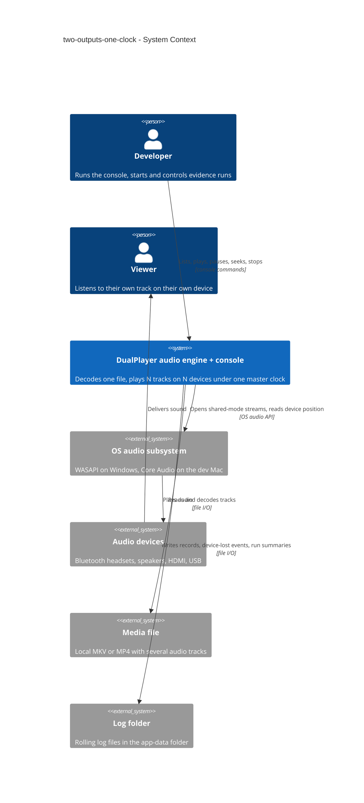
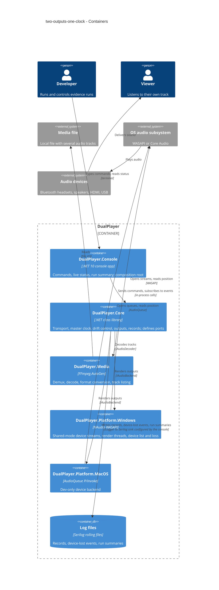
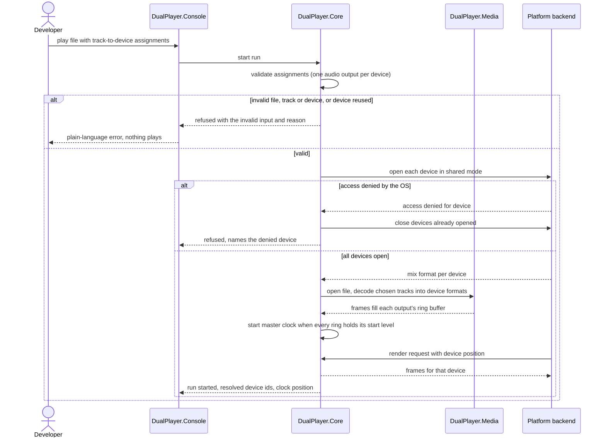
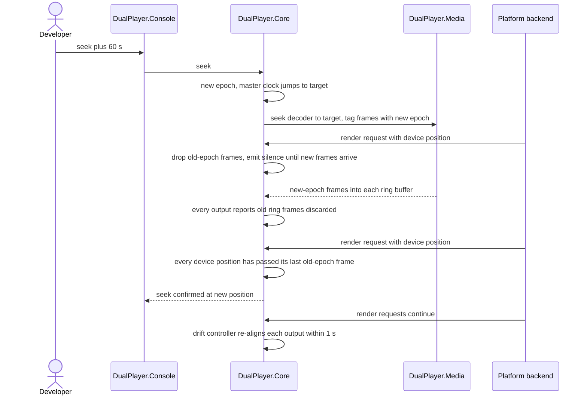
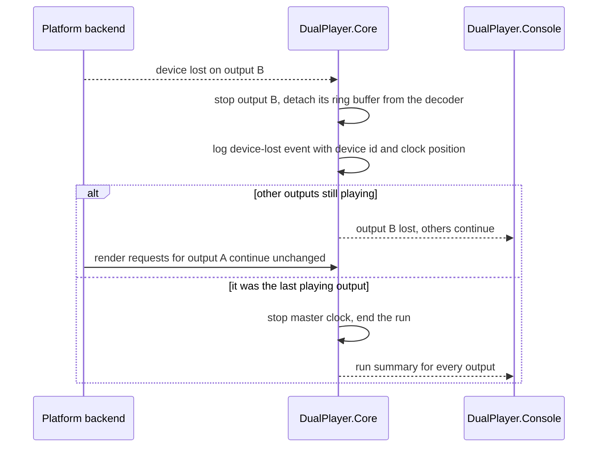

# Software Architecture Document — two-outputs-one-clock

## 1. Introduction and goals

**Intent.** Build the audio engine of DualPlayer: one decode of a media file fans two or more tracks out to audio outputs on different devices, all following one master clock that no single device owns. Each output's drift is measured from its device's reported playback position and corrected continuously; losing one device never disturbs the others; per-device drift, correction and underrun records are published for later steps. The step ships as a Developer console (play, pause, seek, stop, device and track listing) and is accepted only after a recorded ≥ 3 h run on the target Windows PC (spec §1, §2).

**Top-3 quality goals (1-liners; full scenarios in §10):**

1. **Sync accuracy over a feature-length run** — every audio output stays within ≤ 10 ms of the master clock for ≥ 3 h without Developer help, and re-aligns ≤ 1 s after start, resume or seek.
2. **Fault isolation between outputs** — losing one device never stops or disturbs the other outputs (0 underruns within ±5 s of the loss).
3. **Glitch-free continuity at low cost** — 0 underruns per 3 h run with two Bluetooth headsets, at ≤ 5 % CPU, in shared mode.

**Stakeholders.**

| Role | Interest | Sign-off owner? |
|---|---|---|
| Developer (Volodymyr Kravchuk, project owner; approves this SAD in the Tech Lead role) | Runs the console, starts evidence runs, reads counters and the run summary; consumes the evidence for roadmap steps 4–6 | Yes |
| Viewer | Hears their own track without drift or interruption | No |

## 2. Constraints

**Technical.**
- C# on .NET 10 LTS; every project targets plain `net10.0` so the solution builds on macOS ([ADR-0001](../../adr/0001-use-dotnet10-and-avalonia.md)).
- Ports and adapters: `DualPlayer.Core` references only the BCL and `Microsoft.Extensions.*.Abstractions` — no OS, UI or native library; OS code lives in `DualPlayer.Platform.Windows` / `.MacOS`, codec code in `DualPlayer.Media` ([ADR-0003](../../adr/0003-organize-code-as-core-with-platform-adapters.md)).
- Audio output sits behind the `IAudioBackend` port: Windows adapter on NAudio's WASAPI layer with the engine's own N-device event-driven render loop and MMCSS "Pro Audio"; a dev-only AudioQueue P/Invoke adapter on macOS that is never shipped and not held to sync targets ([ADR-0002](../../adr/0002-put-audio-output-behind-a-backend-port.md)).
- Audio decode through FFmpeg via FFmpeg.AutoGen; FFmpeg is LGPL — dynamic linking only, LGPL builds only; on the dev Mac it is installed outside the repo (Homebrew).
- Devices are opened in shared mode (the OS mixes the player with other applications); every spec §6 target is measured under that condition (spec §1).
- Target Windows 11 x64; development on macOS.
- Logging through `ILogger<T>` with the Serilog rolling-file sink already wired in `src/DualPlayer.App/Program.cs`.

**Organisational.**
- One owner (Volodymyr Kravchuk) builds and measures; no external deadline (spec §1, `idea-brief.md §4`); this step is on the roadmap critical path for steps 4, 5 and 6.
- Acceptance needs the target Windows PC with two Bluetooth headsets for a recorded ≥ 3 h run (spec §7).

**Conventions.**
- Project rules in [`CLAUDE.md`](../../../CLAUDE.md) and [`docs/architecture-map.md`](../../architecture-map.md) §Conventions.
- Expected runtime failures (device lost, file unreadable, decoder error) travel as `Result` / `Result<T>` (`src/DualPlayer.Core/Result.cs`) or a domain event — never thrown across module boundaries; exceptions mean bugs and are logged at the top of each background loop.
- No `DateTime.Now` / `Stopwatch` in Core — time comes from an injected `TimeProvider` or the audio master clock.
- Audio render loops run on dedicated threads (MMCSS on Windows), never on a UI thread.
- Devices keyed by the OS endpoint id string.
- Each module exposes `Add<Module>(this IServiceCollection)`; `DualPlayer.App/CompositionRoot.cs` is today the only composition root (how the console host relates to it is decided in §4).

**Regulatory / external.**
- No regulated data. Device names reported by the OS may contain a person's name; they stay in local logs and run summaries unless the Developer reviews and commits a summary (spec §6.1).
- Log growth is capped by size so multi-hour runs cannot fill the disk (spec §6.1 abuse case; size set in §8).

## 3. Context and scope

The engine decodes one local media file and plays chosen tracks on several audio devices for two Viewers, under one master clock. In this step the only operator is the Developer, through a console program; the Viewers only listen. Everything runs on one local PC: no network, no accounts, no remote services.

<!-- brownfield: skeleton from roadmap step 2 (`6cb3a7b`) — Core holds only Result + Settings/state store; Media, Platform.Windows, Platform.MacOS are empty registration stubs; App is an Avalonia shell with CompositionRoot + Serilog daily rolling file (14 files, no size cap); no audio, decode or console code exists yet. -->

**External systems (in / out):**

| Actor or system | Type | Interaction |
|---|---|---|
| Developer | Person | Lists devices and tracks, starts a run, pauses, resumes, seeks, stops; reads live records and the run summary |
| Viewer | Person | Listens to their own track on their own device |
| OS audio subsystem (WASAPI on Windows, Core Audio on the dev Mac) | System (external) | Enumerates playback devices, opens shared-mode streams, reports device playback position, signals device loss and access denial |
| Audio devices (Bluetooth headsets, speakers, HDMI, USB) | System (external) | Play the rendered audio for each Viewer |
| Media file | System (external, local file) | Read-only source of the audio tracks; may be malformed or hostile |
| Log folder (app-data `logs/`) | System (external, local disk) | Receives per-device records, device-lost events and run summaries |

**C4 Context (L1):**



## 4. Solution strategy

**Target surface: `cli`.** The only new surface is the Developer console. The engine itself lives in the existing internal modules (`Core`, `Media`, `Platform.*`) behind Core ports, which roadmap step 4 reuses inside `DualPlayer.App`; it is not a published library, so no separate public-API contract is kept. The surface is a single one and does not cross the blast-radius gate on its own; where the console lives does — see choice 1.

**Top strategic choices (the seeds for ADRs):**

1. **A separate console executable with its own composition root** — `src/DualPlayer.Console` calls the same `Add<Module>()` registrations as `DualPlayer.App` and selects the platform the same way. A real console process gets Ctrl+C and window-close signals natively, which AC-13 needs for the run summary, and keeps console code out of the couch UI ([ADR-0001](adr/0001-host-the-developer-console-as-a-separate-executable.md)).
2. **Decode once, fan out through per-output ring buffers to one render thread per device** — one decode thread demuxes the file once, converts each chosen track to its device's format and fills that output's ring buffer (seconds deep); each device has its own event-driven render thread that reads only its ring. A lost or stalled device stops only its own thread, and the decoder never waits on one full ring — an output that stops reading for more than 1 s is marked stalled and no longer paces the decoder (QG-2); the deep ring absorbs decoder hiccups (QG-3) ([ADR-0002](adr/0002-fan-out-one-decoder-to-per-device-render-threads-through-ring-buffers.md)).
3. **Correct drift on the render side, after the ring** — a proportional-integral controller in `Core/Sync/` compares each device's reported playback position with the master clock and sets a near-unity rate ratio on a managed adaptive resampler that sits between the ring and the device; a one-step re-alignment drops or inserts frames at the same point. The correction takes effect within one device period, so the loop stays stable inside the 10 ms tolerance (QG-1) and is fully testable with fakes ([ADR-0003](adr/0003-correct-drift-with-a-managed-adaptive-resampler-after-the-ring-buffer.md)).
4. **A master clock owned by no device** (committed in spec §1, not re-opened here) — the master clock advances with the PC's monotonic clock read through the injected `TimeProvider`, stops on pause and jumps on seek; devices follow it, so losing any device never stops the timeline (CONTEXT invariant).

Each tactical decision in later sections should trace to one of these seeds. Tactical decisions that *contradict* a strategic choice are red flags — surface them in §11.

## 5. Building block view

Ports and adapters, as the repo already does (ADR-0003 of the repo): the engine — transport, master clock, drift control, output model, records — is plain C# in `DualPlayer.Core`, talking to decoding and to devices only through Core ports. `DualPlayer.Media` implements decoding and format conversion with FFmpeg; `DualPlayer.Platform.Windows` implements the device side with WASAPI; `DualPlayer.Platform.MacOS` implements the dev-only device side; `DualPlayer.Console` is the composition root and the text front-end. The style keeps every sync decision testable with a fake clock and fake devices.

**Port contracts.**
- `IAudioBackend` lists the playback devices the OS offers right now (`ListDevices()` — name, type when known, endpoint id; AC-02, AC-03) and opens one by id (`Open(deviceId)`), returning an `IAudioDevice`: the open shared-mode stream with its mix format, start/close and loss/denial events. Hotplug (`IDeviceWatcher`) stays with roadmap step 5; this feature does not create it.
- The device stream is pull-based: the backend opens a device in shared mode, reports its mix format, owns that device's render thread and calls a Core-provided source with a buffer to fill and the device's playback position (frames played + monotonic timestamp); device loss and access denial arrive as backend events ([ADR-0004](adr/0004-let-the-audio-backend-pull-frames-from-core-with-the-device-position.md)).
- `IAudioDecoder` lists a file's audio tracks and decodes the chosen ones once, converting each output's track to that output's device mix format with FFmpeg swresample — fold-down drops LFE, fewer-channel tracks go to the front channels, no upmix ([ADR-0005](adr/0005-convert-tracks-to-the-device-mix-format-with-ffmpeg-swresample-in-media.md)).

**Internal decomposition:**

```
src/DualPlayer.Core/
├── Playback/      engine facade, transport state machine (stopped/playing/paused/ended), run lifecycle, commands
├── Sync/          master clock, drift controller (PI), adaptive resampler, one-step re-alignment
├── Outputs/       audio output model, output assignment validation ("one audio output per device"), ring buffer
├── Diagnostics/   per-device sync record, excursion tracker, run summary, counters
└── ports          IAudioDecoder (Playback/), IAudioBackend + IAudioDevice (Outputs/)
src/DualPlayer.Media/
└── Audio/         FFmpeg demux + decode of chosen tracks, conversion to each device's format, track listing
src/DualPlayer.Platform.Windows/
└── Audio/         WASAPI shared-mode device streams, event-driven render threads (MMCSS), device list, loss/denial signals
src/DualPlayer.Platform.MacOS/
└── Audio/         AudioQueue dev backend (same port, no sync targets)
src/DualPlayer.Console/   (new — ADR-0001)
├── Program.cs           composition root: Add<Module>() + platform selection + Serilog
├── Commands/            command parser and loop (devices, tracks, play, pause, resume, seek, stop)
└── Rendering/           live status lines, record lines, run summary printout
```

**C4 Container (L2):**



## 6. Runtime view

All commands and backend events enter the engine through one engine-control loop in `DualPlayer.Core` that handles them one at a time, so transport state never races. Every seek or stop bumps a playback **epoch**: frames carry the epoch they were decoded in, and a render source discards frames from an older epoch ([ADR-0006](adr/0006-coordinate-pause-and-seek-with-playback-epochs-while-device-streams-keep-running.md)). Seeded flows below; the `sequences` stage covers every remaining AC.

**Critical flow 1: start a run (AC-01, AC-03, AC-04, AC-05; ≤ 2 s to audio)**



**Critical flow 2: seek while playing (AC-09; recovery ≤ 1 s)**



**Critical flow 3: one device lost while others play (AC-06, AC-06b)**



## 7. Deployment view

One process, `DualPlayer.Console`, runs on one PC: the target Windows 11 x64 PC for evidence runs, the dev Mac for development (dev backend, no sync targets). It is started from the repository with `dotnet run --project src/DualPlayer.Console` or as a `win-x64` build output; no installer in this step (roadmap step 13). FFmpeg's LGPL shared libraries are fetched on Windows by `build/fetch-ffmpeg.ps1`, which downloads one pinned LGPL win-x64 shared build, checks its SHA-256 and unpacks it into a git-ignored folder; the console project copies the DLLs beside its executable. The pinned FFmpeg major version matches the FFmpeg.AutoGen package version. On the dev Mac FFmpeg comes from Homebrew. Logs go to the per-user app-data `logs/` folder.

**Monitoring:**
- Per-device sync record once per second (drift, current correction in ppm, cumulative underruns, device id, master-clock position) — console line + structured log event (AC-11).
- Excursion events (device, peak, duration, start position) when an output leaves the 10 ms tolerance (AC-07); device-lost events (AC-06).
- Run summary per output at the end of the run (AC-13).
- Start-to-audio timing: timestamps of the start command and of the first rendered frame per device in the log (spec §6, ≤ 2 s).
- Actual shared-mode device buffer and mix format per device logged when each stream opens (the OS may grant a larger buffer than requested).
- CPU: the OS performance counter for the console process, averaged over the run (spec §6, ≤ 5 %).

**Scaling thresholds:**
- Buffer defaults, held in an `EngineOptions` record and overridable by console flags without rebuilding: ring buffer 2 s per output; start level 0.5 s in every ring before the master clock starts; requested shared-mode device buffer 40 ms (event-driven, about 10 ms device period).
- Memory: about 0.8 MB of ring per stereo 48 kHz float output at 2 s — comfortable for the ≥ 3 outputs spec §6 asks for.
- Threads: one decode thread, one render thread per device, one engine-control loop, one console input loop.

## 8. Crosscutting concepts

| Concept | Convention | Where defined |
|---|---|---|
| Logging | `ILogger<T>` everywhere; Serilog rolling file in the app-data `logs/` folder. **Override:** roll on 20 MB file size (`rollOnFileSizeLimit`) and keep at most 10 files (≤ 200 MB total); a ≥ 3 h run with three devices writes about 7 MB of records, so rollover removes only older runs (spec §6.1). Applied to both composition roots. | CLAUDE.md §Logging; here |
| Engine events | One `IObservable<EngineEvent>` stream from the engine-control loop: `SyncRecord` once per second per device, excursion, device lost, run summary; each also written as a structured log event ([ADR-0007](adr/0007-publish-engine-events-as-an-observable-stream-from-the-engine-control-loop.md)) | here |
| Real-time code | **Override:** code called on a render thread (`Render`, resampler, ring read) never allocates, locks, logs, awaits or throws; it only reads its ring and updates atomic counters; faults are reported to the control loop as events | here |
| Error handling | Expected failures (file unreadable, track or device invalid, access denied, device lost) are `Result` / `Result<T>` or engine events with a plain-language message for the console; exceptions are bugs, logged at the top of each background loop (decode, control, console); a bug in one render loop stops that output only | CLAUDE.md §Errors |
| Time and clocks | No `DateTime.Now` / `Stopwatch` in Core; the master clock and record cadence read the injected `TimeProvider`; device positions are converted by each adapter to the same monotonic base (ADR-0004) | CLAUDE.md §Time and clocks |
| Threading | One decode thread, one render thread per device (MMCSS "Pro Audio" on Windows), one engine-control loop processing commands and backend events in order, one console input loop | CLAUDE.md §Threading; ADR-0002, ADR-0006 |
| ID strategy | Devices keyed by the OS endpoint id string; tracks numbered from 1 among the file's audio tracks (AC-02); runs are not persisted, so no run id beyond the log timestamp | CLAUDE.md §IDs |
| Configuration | `EngineOptions` record (buffer sizes, start level, tolerance) with defaults from §7, overridable by console flags; not persisted (no `IStateStore` change) | here |
| App paths | **Override:** the `AppPaths` record and its `FromRoot(...)` (no OS check) move from `DualPlayer.App` to `DualPlayer.Core` so both composition roots share it; the OS-specific app-data root (`%APPDATA%` vs `~/Library/Application Support`) stays in the composition roots, next to platform selection, as CLAUDE.md requires | here |
| Internationalisation | N/A — console text in English; the Ukrainian UI belongs to roadmap step 8 | — |
| Authentication / authorization | N/A — local single-user console; the OS device-access check is surfaced as AC-04 | spec §6.1 |

## 9. Architecture decisions

| # | Title | Status | Section |
|---|---|---|---|
| 0001 | Host the Developer console as a separate DualPlayer.Console executable with its own composition root | Accepted | §4 |
| 0002 | Fan one decoder out to per-device render threads through per-output ring buffers | Accepted | §4 |
| 0003 | Correct drift with a managed adaptive resampler on the render side, after the ring buffer | Accepted | §4 |
| 0004 | Let the audio backend pull frames from Core, passing the device's playback position on every call | Accepted | §5 |
| 0005 | Convert each track to its device's mix format with FFmpeg swresample in DualPlayer.Media | Accepted | §5 |
| 0006 | Coordinate pause and seek with playback epochs while device streams keep running | Accepted | §6 |
| 0007 | Publish per-device records and other engine events as one observable stream from the engine-control loop | Accepted | §8 |

ADR files live under `docs/features/two-outputs-one-clock/adr/NNNN-<title>.md`.

## 10. Quality requirements

All numbers are spec §6 targets on the target Windows 11 PC; the macOS dev backend is not held to them (repo ADR-0002).

**QG-1. Sync accuracy over a feature-length run**
- **When:** two audio outputs play on both Bluetooth headsets for a ≥ 3 h run on the target PC, with no action from the Developer.
- **Then:** steady-state drift of each audio output from the master clock ≤ 10 ms (absolute) — each record's drift is the average of the device-position readings over its 1 s interval; the largest value outside the recovery windows (the 1 s after start, resume or seek) counts. After start, resume or seek, every output is within the drift tolerance ≤ 1 s after the command.
- **How verify:** (a) unit tests in `tests/DualPlayer.Core.Tests/Sync/` drive the drift controller and adaptive resampler with a fake `TimeProvider` and fake devices whose clocks run fast or slow by a fixed ppm, asserting |drift| ≤ 10 ms in steady state and recovery ≤ 1 s after start, resume and seek; (b) the recorded target-PC evidence run: largest steady-state drift from the AC-11 records and the AC-13 run summary ≤ 10 ms.

**QG-2. Fault isolation between outputs**
- **When:** one device disappears (switched off, unplugged, out of range) while another output plays.
- **Then:** 0 underruns on the surviving output within ±5 s of the device-lost event; the master clock keeps running; the lost output stops and is logged with its device and master-clock position.
- **How verify:** (a) Core test with two fake devices where one raises device lost mid-run, asserting the other's underrun counter does not change within ±5 s; (b) manual disconnect of one headset on the target PC during a run, checked against the AC-11 records around the device-lost event.

**QG-3. Glitch-free continuity at low cost**
- **When:** a ≥ 3 h run with two Bluetooth headsets on the target PC, devices in shared mode.
- **Then:** 0 underruns per 3 h run with two Bluetooth headsets; CPU while playing two tracks ≤ 5 % of total CPU on the target PC.
- **How verify:** underrun counts from the AC-13 run summary of the evidence run; CPU from the OS performance counter for the console process, averaged over the run.

**Supporting scenarios (spec §6):**
- **Start latency** — start command to audio on all outputs ≤ 2 s; verified from log timestamps of the start command and each device's first rendered frame.
- **Output count** — ≥ 3 outputs simultaneously within the drift tolerance; verified by a Core test with three fake devices (no third physical device required).

## 11. Risks and technical debt

| Risk / debt | Severity | Mitigation | Owner |
|---|---|---|---|
| "Done" is only ever exercised on the dev Mac or with fake devices; the Mac backend does not validate Windows timing (repo ADR-0002) | High | Acceptance requires the recorded ≥ 3 h evidence run on the target PC with its run summary committed under `docs/` (spec §7) | Volodymyr Kravchuk |
| Bluetooth devices may report a playback position that differs from what the Viewer hears (codec and headset buffering) — drift could read ≤ 10 ms while perceived offset is larger | Medium | Treat reported position as accurate for drift (spec §8 default); remaining latency belongs to roadmap step 4; resolve the spec §8 question before `/sdd:specify` of step 4 | Volodymyr Kravchuk |
| The managed adaptive resampler (ADR-0003) may add audible artefacts or cost more CPU than budgeted | Medium | Unit tests on sine input (no new spectral peaks above a set level at ±500 ppm); listening check on the dev Mac; CPU measured in the evidence run against ≤ 5 % | Volodymyr Kravchuk |
| GC pauses or JIT on render threads cause underruns that look like device problems | Medium | §8 real-time rule (no allocation on render threads), pre-allocated rings and buffers, warm-up before the master clock starts; underruns logged with master-clock position for correlation | Volodymyr Kravchuk |
| Crackling caused outside the player (adapter, radio) may persist while the engine counts 0 underruns | Medium | Underrun counter measures the engine only (spec §8 default); resolve the spec §8 question before the evidence run; roadmap step 1 investigates the adapter side | Volodymyr Kravchuk |
| FFmpeg binary and FFmpeg.AutoGen versions drift apart, or a GPL build slips in | Medium | `build/fetch-ffmpeg.ps1` pins one LGPL shared build with SHA-256; FFmpeg major version pinned to the FFmpeg.AutoGen package; console logs FFmpeg version and license at start | Volodymyr Kravchuk |
| The OS grants a larger shared-mode buffer than the requested 40 ms, slowing seek confirmation and pause alignment | Low | Actual buffer logged per device at stream open; `EngineOptions` lets the Developer tune it on the target PC | Volodymyr Kravchuk |
| The two composition roots (`DualPlayer.App`, `DualPlayer.Console`) drift apart in what they register | Low | Smoke test per root; both call the same `Add<Module>()` extensions; CLAUDE.md rule updated to name both roots | Volodymyr Kravchuk |
| `docs/architecture-map.md` still reflects the pre-scaffold plan (`reflects_commit: 546fd39`) and does not list `DualPlayer.Console` | Low | Re-run `/sdd:survey` after this feature's skeleton lands | Volodymyr Kravchuk |
| Which devices join the evidence run besides the two Bluetooth headsets is not decided (spec §8) | Low | Default: add one wired output if available; decide before `/sdd:tasks` | Volodymyr Kravchuk |

**Accepted debt (acceptable in v1, plan to fix later):**
- Runs and their summaries are not persisted as state; they live in the log and in summaries the Developer commits by hand.
- Console text is English only; the Ukrainian UI belongs to roadmap step 8.
- No automatic reconnect of a lost device (roadmap step 5).
- Devices keep consuming silence while paused (ADR-0006).

## 12. Glossary

Canonical domain terms come from the repo-root [`CONTEXT.md`](../../../CONTEXT.md); the rows marked *(design)* are technical terms introduced by this SAD.

| Term | Meaning |
|---|---|
| Audio output | One listening channel of the player: a track played on a device with its own volume and offset (CONTEXT) |
| Correction | The adjustment that brings an audio output back to the master clock: the continuous rate adjustment in ppm, counted only when the position is re-aligned in one step (CONTEXT) |
| Developer | The project owner who builds, runs and measures the player through the console (CONTEXT) |
| Device | An audio endpoint the OS exposes, identified by its OS endpoint id (CONTEXT) |
| Drift | How far an audio output's playback position has moved from the master clock (CONTEXT) |
| Master clock | The single playback timeline every audio output follows; keeps running when any one device stops (CONTEXT) |
| Run summary | The per-output account of one run printed and logged when playback stops (CONTEXT) |
| Track | One audio stream inside the media file (CONTEXT) |
| Underrun | A moment when a device had no audio ready to play (CONTEXT) |
| Viewer | One of the people watching, each listening to their own audio output (CONTEXT) |
| One audio output per device | Invariant: a device can never be assigned to two audio outputs at once (CONTEXT, AC-05) |
| Run | One playback session from the start command until the file ends, the Developer stops, or the last device is lost (spec AC-13) — *candidate for `/sdd:glossary`* |
| Excursion | A stretch of time during which an output is outside the 10 ms drift tolerance, recorded once with device, peak, duration and start position (spec AC-07) — *candidate for `/sdd:glossary`* |
| Device clock mismatch | A device clock's rate relative to the master clock, in ppm (spec AC-13) — *candidate for `/sdd:glossary`* |
| Epoch *(design)* | A counter bumped on every seek and stop; frames carry the epoch they were decoded in, and older-epoch frames are discarded (ADR-0006) |
| Ring buffer *(design)* | A per-output single-producer/single-consumer buffer of decoded audio in device format between the decode thread and the render thread (ADR-0002) |
| Render source *(design)* | The Core object a backend calls on its render thread to fill the device buffer, given the device's playback position (ADR-0004) |
| Engine-control loop *(design)* | The single loop in Core that applies commands and backend events one at a time and publishes engine events (ADR-0006, ADR-0007) |
| Mix format *(design)* | The sample rate, channel layout and sample type the OS fixes for a device in shared mode (ADR-0005) |
| Start level *(design)* | The amount of audio every ring must hold before the master clock starts (0.5 s default, §7) |
