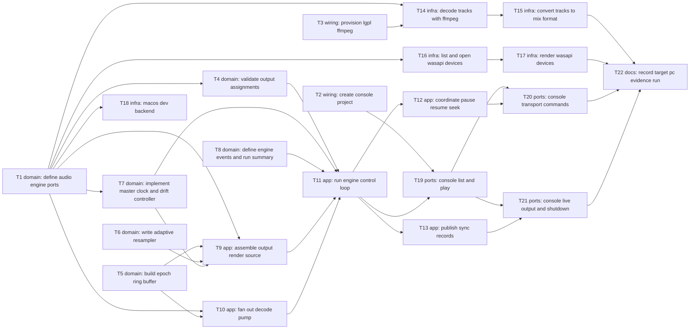

# Epic — two-outputs-one-clock

> **Spec:** [spec.md](../spec.md) · **Design:** [sad.md](../sad.md) · **Data model:** none (no schema change — every persisted item is a log record, sad §6 flags) · **API:** [cli.md](../contracts/cli.md) · **ADRs:** [adr/](../adr/)

## Goal

Ship the DualPlayer audio engine: one decode drives two or more audio outputs on different devices that stay within 10 ms of one master clock for a feature-length run, react to pause, resume and seek together, and survive the loss of any one device. The Developer drives it through `DualPlayer.Console`, and the step closes on a recorded ≥ 3 h run on the target Windows PC (spec §2).

## Scope

- **In:** `DualPlayer.Core` (`Playback/`, `Sync/`, `Outputs/`, `Diagnostics/`, ports, `AppPaths`), `DualPlayer.Media` (FFmpeg decode + swresample conversion), `DualPlayer.Platform.Windows` (WASAPI shared-mode backend), `DualPlayer.Platform.MacOS` (dev-only AudioQueue backend), the new `DualPlayer.Console`, FFmpeg provisioning and CI, the evidence run.
- **Out:** video and latency compensation (step 4); hotplug, reconnect, device picker, volume, dialogue-normalized downmix (step 5); diagnostic hints and Hands-Free detection (step 6); crackling outside the player (steps 1, 7); external audio files; sync targets on macOS (spec §3).

## Task map

- **Wave 1:** T1, T2, T3, T5, T6, T8
- **Wave 2:** T4, T7, T10, T14, T16, T18
- **Wave 3:** T9, T15, T17
- **Wave 4:** T11
- **Wave 5:** T12, T13, T19
- **Wave 6:** T20, T21
- **Wave 7:** T22

## Tasks

See [tracker.md](./tracker.md) for status. Machine contract: [tasks.json](../tasks.json).

| # | Task | Layer | Blocked by | DoD (short) |
|---|---|---|---|---|
| T1 | [Define the audio engine ports, value types and test fakes in Core](./T1-define-audio-engine-ports.md) | domain | — | Ports + fakes compile; fake-device ppm/loss test passes |
| T2 | [Create the DualPlayer.Console executable with its own composition root and capped logging](./T2-create-console-project.md) | wiring | — | Console project builds; both smoke tests pass; log cap 20 MB × 10 |
| T3 | [Provision LGPL FFmpeg for the dev Mac, CI and the Windows build](./T3-provision-lgpl-ffmpeg.md) | wiring | — | FFmpeg loads on Mac + both CI jobs; fetch script pins LGPL by SHA-256 |
| T4 | [Validate output assignments and resolve devices by list number or OS id](./T4-validate-output-assignments.md) | domain | T1 | Validator tests pass incl. duplicate-device refusal |
| T5 | [Build the epoch-tagged single-producer/single-consumer ring buffer](./T5-build-epoch-ring-buffer.md) | domain | — | Ring tests incl. SPSC stress + zero-alloc read pass |
| T6 | [Write the managed adaptive resampler with one-step re-alignment](./T6-write-adaptive-resampler.md) | domain | — | Sine tests at ±500 ppm, realign exactness, zero-alloc pass |
| T7 | [Implement the master clock, drift measurement, PI drift controller and clock-mismatch estimate](./T7-implement-master-clock-and-drift-controller.md) | domain | T1 | Closed-loop fake-clock tests: ≤ 10 ms steady, ≤ 1 s recovery |
| T8 | [Define engine events, the excursion tracker and the run-summary builder](./T8-define-engine-events-and-run-summary.md) | domain | — | Excursion + run-summary tests pass |
| T9 | [Assemble the per-output render source: epoch discard, drift-corrected read, silence instant and underrun counting](./T9-assemble-output-render-source.md) | app | T1, T5, T6, T7 | Render-source tests incl. zero-alloc pass |
| T10 | [Fan one decoder out to the output rings with epochs, full-ring dropping and stall detection](./T10-fan-out-decode-pump.md) | app | T1, T5 | Decode-pump tests: fan-out, stall, drop, detach, epoch |
| T11 | [Run the engine-control loop: start a run, stop it, and end it on file end or device loss](./T11-run-engine-control-loop.md) | app | T4, T7, T8, T9, T10 | Run lifecycle tests: start, denial, loss (±5 s), last loss, stop summary |
| T12 | [Pause, resume and seek every output together with playback epochs](./T12-coordinate-pause-resume-seek.md) | app | T11 | Transport tests: pause align ≤ 10 ms, seek gate, recovery ≤ 1 s, out-of-range |
| T13 | [Publish per-device sync records, excursions and one-step corrections once per second](./T13-publish-sync-records.md) | app | T11 | 1 s records + logs; simulated 3 h, 3 outputs ≤ 10 ms |
| T14 | [List a file's audio tracks and decode the chosen ones once with FFmpeg](./T14-decode-tracks-with-ffmpeg.md) | infra | T1, T3 | Track listing, unreadable-file refusal, one-pass decode, seek tests pass |
| T15 | [Convert each output's track to its device mix format with swresample and a fold-down matrix](./T15-convert-tracks-to-mix-format.md) | infra | T14 | Fold-down / resample / no-upmix tests pass |
| T16 | [List Windows playback devices and open them in shared mode, reporting access denial](./T16-list-and-open-wasapi-devices.md) | infra | T1 | HRESULT mapping tests; hardware list/open tests on target PC |
| T17 | [Render each Windows device on its own MMCSS thread with the device position and the loss signal](./T17-render-wasapi-devices.md) | infra | T16 | QPC conversion test; hardware render + loss test on target PC |
| T18 | [Provide the macOS AudioQueue development backend behind the same port](./T18-macos-dev-backend.md) | infra | T1 | Dev Mac lists devices + plays a tone; Windows CI green |
| T19 | [Console: list devices and tracks, and start a run from command-line arguments](./T19-console-list-and-play.md) | ports | T2, T11 | devices/tracks/play output, error codes and exit codes match cli.md |
| T20 | [Console: pause, resume, seek and stop a running run from standard input](./T20-console-transport-commands.md) | ports | T19, T12 | Transport commands print cli.md §1.4 lines |
| T21 | [Console: print sync records, excursions, device loss and the run summary, also on Ctrl+C and window close](./T21-console-live-output-and-shutdown.md) | ports | T19, T13 | Live lines + summary on stop/Ctrl+C/close; exit 3 on all lost |
| T22 | [Record the ≥ 3 h evidence run on the target Windows PC and commit its run summary](./T22-record-target-pc-evidence-run.md) | docs | T15, T17, T20, T21 | ≥ 3 h target-PC summary committed under docs/ |

## Risks / Hard rules

- **Core purity** — `DualPlayer.Core` references only the BCL + `Microsoft.Extensions.*.Abstractions`; OS code in `Platform.*`, codec code in `Media` (sad §2).
- **Real-time rule** — code on a render thread (`Render`, resampler, ring read) never allocates, locks, logs, awaits or throws (sad §8). T5, T6, T9 assert zero allocation in tests.
- **Errors** — expected failures are `Result` / engine events with the `contracts/cli.md` §4 codes; exceptions are bugs, logged at the top of each loop (sad §8).
- **Time** — no `DateTime.Now` / `Stopwatch` in Core; everything on the injected `TimeProvider`, device timestamps converted to that base by each adapter (sad §8, ADR-0004).
- **LGPL** — FFmpeg dynamic linking only; the Windows build is a pinned LGPL shared build (CLAUDE.md, sad §7).
- **Fakes are not acceptance** — the step is accepted only by T22's recorded target-PC run (sad §11, risk 1).
- **Window close** — the run summary must be written within the few seconds Windows gives a closing console (sad §6 flag → T21).
- **Lanes** — T11 → T12 → T13 share `EngineControlLoop.cs`; T14 → T15 share `FfmpegDecodeSession.cs`; T16 → T17 share `WasapiAudioDevice.cs`; T1/T3/T16 share `Directory.Packages.props`; T2/T3/T18 share `DualPlayer.slnx`; T19 → T20 and T19 → T21 share console files (T20 and T21 can run in parallel); T12 and T13 run one after the other — `implement` serializes each lane.
