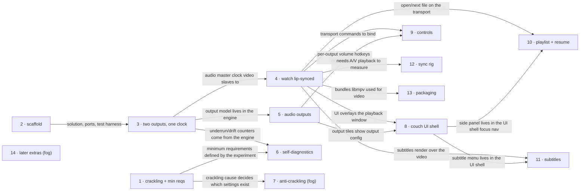

# Roadmap — MediaPlayer (dual-audio-player)

> **A decomposition, not a promise.** The overall idea broken into incremental steps: what each
> step is, where it comes from, how big it is — or that nobody has looked at it yet — and in which
> order, and parallel lanes, we walk them. **No dates** (except shipped history), **no scores** —
> order is the prioritization. The *solution* for any step lives in its `docs/features/<slug>/`
> spec, not here.

## Destination

Two people watch one video on any Windows 11 PC that meets the minimum requirements, each hearing their own audio track on their own audio device lip-synced with the picture without manual calibration, and control it from the couch without a mouse.

## Steps

| # | Step | Source | Size | Status |
|---|---|---|:---:|---|
| 1 | Crackling localized and minimum hardware requirements fixed (experiment on the target PC, no code) | `idea-brief.md §8 Open questions`; `§7 Recommendation` (crackling checks → first roadmap step) | XS | idea |
| 2 | scaffold ([`docs/features/_scaffold/`](features/_scaffold/)): .NET 10 + Avalonia solution (Core / Media / Platform.* / App), test harness + smoke test, state store, logging, CI — builds on macOS, runs on Windows | `architecture-map.md §Module inventory`; `§Stack` | S | spec'd |
| 3 | Two outputs, one clock (console) ([`docs/features/two-outputs-one-clock/`](features/two-outputs-one-clock/)): one decoder fans two tracks out to N audio endpoints, per-device drift correction against the device clock, per-device underrun/drift counters; play/pause/seek on all outputs; other outputs keep playing on device loss (no reconnect); basic multichannel fold-down; raw device/track listing; audio-backend abstraction (WASAPI target, AudioQueue for dev); done after a recorded long run on the target PC | `idea-brief.md §7 Recommendation` (architecture direction items 1, 4); `features/two-outputs-one-clock/spec.md` | L | building — code reviewed (PASS, re-review 8) and PR prepared ([changelog](features/two-outputs-one-clock/CHANGELOG.md)); awaits the target-PC evidence run (T22) before `shipped` |
| 4 | Watch a file lip-synced: fullscreen Avalonia window with libmpv video slaved to the audio clock, video delayed by the largest output latency, automatic latency compensation (Windows-reported + device-type defaults) with per-device manual offset; play/pause/seek (engine-level proven in step 3) wired to video, plus next/prev on all outputs | `idea-brief.md §7 Recommendation` (items 1–3, any audio device); `§1 Raw idea` (PLY-01, PLY-02, PLY-04, AUD-05, AUD-07) | L | idea |
| 5 | Audio outputs: per-output track/device/volume/mute, language auto-select, same-track mode, dialogue-normalized downmix (basic fold-down is step 3); friendly device list with type, hotplug, auto-reconnect (continue-on-loss is step 3) | `idea-brief.md §1 Raw idea` (AUD-01–04, AUD-06, AUD-09, AUD-10, AUD-12); `§7 Recommendation` (any audio device) | L | idea |
| 6 | Self-diagnostics and minimum-requirements check: Hands-Free detection, BT streams per adapter, underrun/drift counters with hints, startup requirements check with software-decoding fallback | `idea-brief.md §7 Recommendation` (items 5, 6) | M | idea |
| 7 | Anti-crackling settings → see [Not yet specified](#not-yet-specified) | `idea-brief.md §7 Recommendation` (anti-crackling player settings) | fog | idea |
| 8 | Couch UI shell: auto-hiding bar over video, output tiles and output menu, notifications, pause screen, settings screen, focus navigation, UI scale, Ukrainian UI | `idea-brief.md §1 Raw idea` (6. UI for distance viewing: UI-01, UI-02, UI-03, UI-05) | L | idea |
| 9 | Controls: keyboard map, media/remote keys, per-output volume hotkeys | `idea-brief.md §1 Raw idea` (7. Controls: CTL-01–03) | S | idea |
| 10 | Playlist and resume: open files/folder, drag-and-drop, natural sort, side panel, auto-advance/repeat, per-file position and tracks, crash resume | `idea-brief.md §1 Raw idea` (5. Playlist: PL-01–05; PLY-03) | M | idea |
| 11 | Subtitles: embedded and external discovery, encoding detection, language auto-select, style settings with live preview, delay | `idea-brief.md §1 Raw idea` (4. Subtitles: SUB-01–05, SUB-07, SUB-08, SUB-10, SUB-11) | L | idea |
| 12 | Developer sync-verification rig: automated click/flash test recorded via microphone or loopback on several machines | `idea-brief.md §7 Recommendation` (item 7) | M | idea |
| 13 | Packaging: self-contained win-x64 build + libmpv, installer | `idea-brief.md §1 Raw idea` (8. Architecture and stack — Delivery) | S | idea |
| 14 | Later extras (S/C requirements incl. phone remote) → see [Not yet specified](#not-yet-specified) | `idea-brief.md §1 Raw idea` (CTL-05, S/C rows); `§5 Out of scope` (Not agreed) | fog | idea |

## Not yet specified

| Area | What we'd have to learn | Blocks | How it gets sharpened |
|---|---|:---:|---|
| Anti-crackling settings | Where the crackling comes from (source track / adapter bandwidth / buffer underruns / interference) — only a software cause makes these settings worth building, and the cause picks which ones | 7 | Step 1 result, then `/sdd:specify` |
| Later extras | Which S/C requirements the owner actually keeps (phone remote, dual subtitles, thumbnails, seek preview, speed, key remap, English UI, .m3u8, Recent page, OpenSubtitles, gamepad, headphone buttons, calibration wizard, >2 outputs in UI, speaker-only mode) | 14 | D5 conversation with the owner |

## Out of scope

- Media-center / cover-art library (Kodi/Plex style) — excluded in the brief.
- Copying graphics and themes of other players — licenses and trademarks.
- Extra hardware beyond a second USB Bluetooth adapter — owner constraint.
- Mandatory user calibration before first use — contradicts the portability goal; manual offset stays only as fine-tuning.

## Open decisions

| # | Question | Type | Owner | Blocks |
|---|---|:---:|:---:|:---:|
| D1 | Is libmpv video slaved to our audio clock via `speed`/`seek` correction precise enough for lip-sync, or is an own FFmpeg video decode/render path needed? (mpv has no external-clock option — [mpv options.rst `--video-sync`](https://github.com/mpv-player/mpv/blob/master/DOCS/man/options.rst)) | prototype | agent | 4 |
| D2 | How to detect Hands-Free (HFP) vs stereo on Windows 11's merged BT endpoint — no documented property; infer from mix-format drop / mic use? ([MS Learn: Bluetooth classic audio](https://learn.microsoft.com/en-us/windows-hardware/drivers/bluetooth/bluetooth-classic-audio)) | prototype | agent | 6 |
| D3 | Can an audio endpoint be mapped to its BT adapter by walking the CfgMgr/SetupAPI parent chain, to count streams per adapter? | prototype | agent | 6 |
| D4 | Where do per-model latency defaults come from — no open dataset exists ([RTINGS latency test](https://www.rtings.com/headphones/tests/connectivity/bluetooth-connection) is not reusable): own table from step 12 measurements, hand-picked per-type defaults, or both? | grilling | human | 4 |
| D5 | Which S/C requirements stay in scope and which become explicit "won't do" (incl. speaker-only mode)? | grilling | human | 14 |
| D6 | Is speaker bleed acceptable for the headphones listener when the other output is speakers? | prototype | human | 5 |

## Decisions so far

- One engine, one master clock, audio fanned out to N endpoints with per-device drift correction (architecture B primary; libmpv may still render video) → [`docs/idea-brief.md §7`](idea-brief.md)
- Any Windows audio endpoint per output (BT, wired, HDMI, USB), aligned by delaying video by the largest latency → [`docs/idea-brief.md §7`](idea-brief.md)
- Sync target is each output lip-synced with the video, not ≤20 ms between outputs → [`docs/idea-brief.md §7`](idea-brief.md)
- Crackling checks are nonblocking and form the first roadmap step → [`docs/idea-brief.md §7`](idea-brief.md)
- Engine is built on existing libs (NAudio WASAPI + FFmpeg.AutoGen) with an own N-device render loop and MMCSS "Pro Audio" P/Invoke → [NAudio WasapiOut.cs](https://github.com/naudio/NAudio/blob/master/NAudio.Wasapi/WasapiOut.cs)
- .NET 10 LTS + Avalonia + CommunityToolkit.Mvvm (instead of the brief's .NET 8) → [ADR-0001](adr/0001-use-dotnet10-and-avalonia.md)
- Audio output behind an `IAudioBackend` port: WASAPI target, AudioQueue P/Invoke for macOS dev → [ADR-0002](adr/0002-put-audio-output-behind-a-backend-port.md)
- Code organized as Core with platform adapters; App is the only composition root → [ADR-0003](adr/0003-organize-code-as-core-with-platform-adapters.md)
- State as versioned JSON files with in-code upgraders → [ADR-0004](adr/0004-store-state-as-versioned-json-files.md)
- Per-device latency offsets and type defaults belong to step 4 in `Core/Sync`, keyed by device id; step 5 does not own latency — keeps 4 ∥ 5 conflict-safe (owner answer in roadmap review) → this file

## Dependency graph

## Execution path

Zones are module paths from [`architecture-map.md`](architecture-map.md) §Module inventory; all are `(new)` until `/sdd:scaffold` materializes them. Every step also adds one `Add<Module>()` line in `src/DualPlayer.App/Program.cs` — a trivial merge, not a zone conflict.

| Wave | Steps | Zone per step (why parallel-safe) | Unlocks |
|:---:|---|---|---|
| 1 | 1 ∥ 2 | 1: `docs/` (experiment notes on the target PC, no code) · 2: whole skeleton — `src/`, `tests/`, `.github/` (new) | 3, 6, 7 |
| 2 | 3 | 3: `src/DualPlayer.Core/Sync/` + `Core/Playback/` + `src/DualPlayer.Media/` (decoder) + `src/DualPlayer.Platform.Windows/` + `src/DualPlayer.Platform.MacOS/` (audio backends) (new) | 4, 5, 6 |
| 3 | 4 ∥ 5 ∥ 6 | 4: `Core/Playback/` + `Core/Sync/` (latency offsets) + `src/DualPlayer.Media/` (video renderer) + `src/DualPlayer.App/Views/` (playback window) (new) · 5: `Core/Outputs/` + `Platform.Windows/` device enumeration and hotplug (new) · 6: `Core/Diagnostics/` + `Platform.Windows/` BT diagnostics (new) — disjoint Core areas, separate Platform.Windows folders | 8, 9, 10, 11, 12, 13 |
| 4 | 8 ∥ 9 ∥ 12 ∥ 13 | 8: `src/DualPlayer.App/Views/` + `App/Controls/` + `App/Themes/` (new) · 9: `src/DualPlayer.App/Input/` (new) · 12: `tools/sync-rig/` (new) · 13: `build/` (new) — disjoint | 10, 11 |
| 5 | 10 ∥ 11 | 10: `Core/Playlist/` + its side-panel view (new) · 11: `Core/Subtitles/` + `Media/` subtitle render + its menu view (new) — separate modules and UI zones | — |

## Shipped

| Step | Shipped | Link |
|---|---|---|
| — | — | — |
